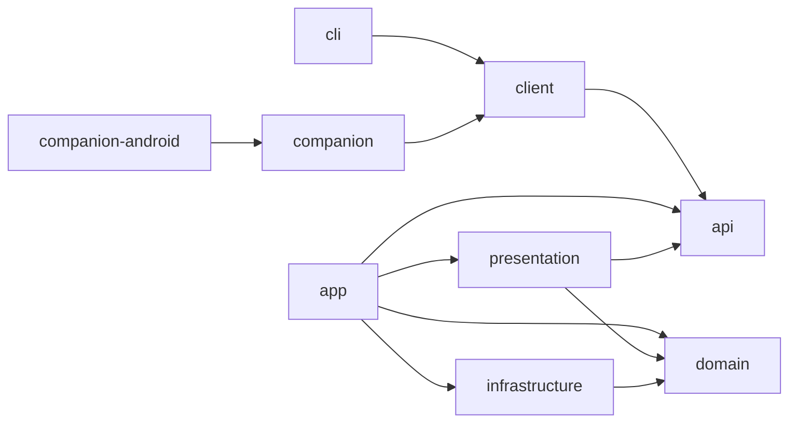
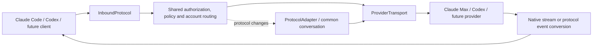

# Architecture

TeamCode is an independent, self-hosted team gateway. Root package and Gradle group: `me.nathanfallet.teamcode`. All project content is English. The module layout follows Asonar's public contract/client and inward-facing server layers. TeamCode does not depend on ControlResell code, credentials, CI, infrastructure, registries or databases.

## Module graph

| Module | Responsibility | Runtime |
| --- | --- | --- |
| api | Serializable DTOs, typed Ktor resources, public error and event contracts | KMP, JVM, desktop Native, Android and iOS |
| client | Typed TeamCode HTTP client, credential supplier and bounded streaming transport; caller supplies the engine | KMP, JVM, desktop Native, Android and iOS |
| cli | Native commands, local proxy, browser login, OS credentials, agent integration and service registration | Kotlin/Native; JVM for fast tests |
| companion | Companion app for iOS, Android and the desktop: Compose Multiplatform UI, Koin, account and credential storage; desktop entry point in `jvmMain` | KMP: JVM desktop, Android, iosArm64, iosSimulatorArm64 |
| companion-android | Android application shell (`me.nathanfallet.teamcode`) around `companion`; the iOS shell is the Xcode project in `companion-ios/` | Android |
| domain | Models, use cases, repository/service ports, admission, fairness, capacity forecasts and model selection | Server JVM; no HTTP or database dependency |
| infrastructure | Provider adapters, OAuth, database, encryption, HTTP transports and telemetry | Server JVM |
| presentation | Typed management API, incoming inference protocols, dashboard and agent-facing MCP gateway (one endpoint per server) | Server JVM |
| app | Server composition root, Koin, configuration, lifecycle and OCI image | JVM 21, Ktor Netty |

Infrastructure does not import public DTOs. Presentation maps domain objects to contracts and invokes use cases. CLI never imports server domain or repositories. Native platform code belongs behind `expect/actual` boundaries. The HTTP client accepts a caller-selected engine and credential supplier; the SDK never owns an operating system keychain.

## Deployment

Stateless server replicas and a shared MySQL database. Use HikariCP and reviewed Flyway migrations; schema tests replay migrations against MySQL. No RabbitMQ or Redis requirement initially. Durable directives and quota reservations live in the database. No database lock spans an inference stream.

The local CLI embeds an HTTP loopback-only Ktor CIO server. Outbound HTTPS uses Ktor 3.6 engine defaults (Darwin on macOS, Curl on Linux, WinHttp on Windows); the dependency is shared across native targets. Server CIO and client CIO are different concerns: never assume Native client TLS works merely because the local HTTP server works. The central server uses Netty on JVM.

Native targets: macosArm64, linuxX64, linuxArm64, mingwX64. `api` and `client` also target Android, iosArm64 and iosSimulatorArm64 for the [companion app](companion.md). Publish target binaries and checksums; document dynamic library requirements. Compile and test on appropriate hosts, not only JVM. Do not promise static binaries or supported targets before their release artifacts pass verification.

## Request lifecycle

1. Authenticate the TeamCode member; derive identity from the credential, never caller-controlled identity headers.
2. Validate endpoint, model capabilities, project policy, output bound and request size.
3. Atomically reserve the member/group/run allowance including other in-flight reservations.
4. Admit through bounded per-member queues and fair scheduling. Recheck policy at dispatch.
5. Select an authorized provider account with conversation affinity, respecting every relevant quota window and protected sub-pool.
6. Stream with backpressure. Record every provider attempt and its usage; stop upstream work on disconnect.
7. Settle the reservation exactly once. Missing final usage retains a conservative provision for reconciliation.

Do not replay after committed output. Keep provider exhaustion, transient throttling, transport failures and member budget denials separate. Credential refresh is serialized per account. Secrets use versioned atomic updates, so a late refresh cannot overwrite newer credentials.

## Public management contracts

The API owns resources, DTOs and serialization. The client exposes resource subclients and accepts an HTTP engine factory. Version management API under `/api/v1`; inference surfaces retain the upstream-compatible `/v1/messages` and `/v1/responses` paths. Publish capabilities so CLI and server can negotiate compatibility rather than guess feature availability. A planned command must not be advertised as implemented.

## Models and protocols

Separate the caller's requested name, team routing profile, actual provider model and selected account. An alias such as `opus -> astra` is a policy, not a statement that the models share capabilities or protocol. Native passthrough preserves opaque provider fields. Cross-provider conversion is experimental and disabled by default through the persistent administrator model-policy flag `experimentalCrossProviderTranslation`; native pooling does not depend on that experiment. Translation is an explicit, tested capability subset: text, tool calls/results, fragmented streaming arguments, stop reasons and errors first. Images and advanced features require their own evidence.

Do not silently discard signed/encrypted reasoning, tool state or unknown required fields. Refuse unsupported capability combinations. Keep routes sticky across tool loops; changing provider requires a compatible session boundary. A paid API fallback or a different data destination requires explicit policy. ChatGPT/Codex subscriptions and OpenAI API credentials are distinct adapters; their tokens are not interchangeable.

## Data and security

Conceptual tables: teams, members, memberships, devices, sessions, service keys, provider accounts, pools, policies, quota observations, reservations, requests, upstream attempts, usage events, route versions, directives, receipts and audit events. Identity and events are team-scoped. IDs, tokens and session names are not metric labels. Telemetry is optional and content-free by default.

Provider credentials are encrypted at rest with the encryption key outside the database. Member/device credentials are revocable and scope-limited. Web sessions use Secure/HttpOnly/SameSite cookies and CSRF protection. Bootstrap is closed by default. There is no public registration. First-run bootstrap creates the administrator once; administrators create other users through the dashboard. Temporary passwords must be replaced before using the gateway.

`ServiceKeyService` provides hashed, expiring CI credentials tied to a member ledger. The principal carries explicit service scopes; domain authorization and a closed transport action classification prevent unattended credentials from inheriting interactive administrator privileges (the one read-only exception is an administrator's `team:read` key, see [service credentials](service-keys.md#team-wide-read-access)). Current SQL permissions are rechecked before admission and cancellation. See [service credentials](service-keys.md).

`DeviceService` exposes owner/administrator device and authentication-session management. `SqlDeviceService` uses Exposed device records and nullable references on login tokens. Registration is keyed by member/installation UUID, serializes with revocation on the member row and preserves edited names. Devices do not own fairness balances: every token on every device still shares the member ledger. Old tokens migrate with unknown device/creation metadata. The native installation UUID is separate from credentials and survives logout; atomic no-replacement publication prevents concurrent first logins from inventing separate identities. See [device lifecycle, API and authorization](devices.md).

Metrics describe bounded operational outcomes; individual usage is protected management data. Do not log prompts, responses, credentials or raw provider error bodies. Store only metadata unless an operator explicitly opts into a documented, short-lived diagnostic mode.

### Transaction boundaries

Persistence uses the Exposed DSL behind domain ports, HikariCP for connection pooling and Flyway for MySQL migration execution. All queries, conditional updates and row locks must use typed Exposed expressions, including test fixtures; raw SQL execution is not permitted. Generate new migrations from Exposed table definitions and review their output without changing previously published migration checksums. Database types stay inside infrastructure. Application and fixture queries use this convention, including quota admission, credential refresh and delivery leases. The module-boundary check also rejects raw SQL/JDBC execution in Kotlin sources. Transactions use database time and read-committed isolation, with automatic transaction retries disabled so a failed operation is never silently replayed. SQL statement logging is disabled to protect bound credentials.

Run `python3 scripts/generate-migrations.py` after changing the table definitions. The wrapper starts its own loopback-only MySQL 8.4 container with a temporary memory-backed data directory, invokes the Exposed Gradle migration generator and stops only that container. The generator replays the committed Flyway history and writes candidate DDL; review it before committing, especially renames, drops and MySQL type changes. It never targets the configured TeamCode server database. The schema source lives in `infrastructure/database/tables`; Exposed and migration-generation dependencies stay out of the native CLI.

## Admission across replicas

`AwaitAdmissionUseCase` owns the bounded cancellable wait; `AdmissionQueueStore` is its persistence port. `SqlAdmissionStore` implements it through Exposed tables `admission_waiters` and `admission_turns`. Queue selection, policy revalidation and reservation creation share the team-locked transaction. No database transaction or connection remains open between polling attempts. Pending bodies and live sockets remain request-local; all cross-replica scheduling metadata and leases live in MySQL. No Redis is required for this implementation.

Ktor's route-scoped `HttpRequestLifecycle` enables `cancelCallOnClose` on inference endpoints in both the central server and local CLI proxy. This also cancels work waiting before response headers. Management and enrollment routes retain their existing lifecycle. Real TCP regressions cover the server and native CLI, because coroutine-only tests cannot establish socket-close propagation.

The SDK gives each inference call its own HTTP engine and closes that engine on cancellation, with an explicit request-job cancellation guard. A shared native engine can retain a request waiting for headers even after its caller is cancelled; this was reproduced with Ktor 3.6.0 on Linux and observed on Windows CI. Isolating ownership fixed the Linux fixture, but Windows still retained its upstream TCP connection after the close path ran. Engine disposal alone is therefore not the cancellation contract. Closing the SDK also cancels its active inference transports. Management calls retain their shared client. The HTTP factory supplied to the SDK must create independently owned clients, and the universal engine dependency remains unchanged. Inference engine/TLS setup overhead remains part of performance acceptance.

Each SDK inference carries a fresh `x-teamcode-client-request-id` UUID. This is internal cancellation metadata, separate from the server's attempt ID and session hints; it never enters the provider header map. Cancelling before the response consumer completes sends `POST /api/v1/requests/{id}/cancel` with the original request's member credential. A separate control client survives SDK shutdown. Only this idempotent control call may retry (at most twice, within a 2.5-second cleanup deadline); inference itself is never replayed. A completed response does not send cancellation. Older servers may reject the control endpoint: upgrade all replicas and clients before relying on it.

`RequestCancellationService` wraps the entire gateway operation, including queueing, provider fallback and response consumption. It checks before dispatch and polls the shared `request_cancellations` table every 500 ms while authenticated work runs. Direct/legacy clients without a control UUID receive a server-only identifier for session revalidation; unauthenticated development fixtures retain their separate behavior. A database failure ends the monitored operation instead of leaving it running unobserved. Cancellation writes revalidate the session under the team lock. Markers are scoped to team/member/UUID and expire after ten minutes, with at most 256 per member and 4,096 per team. Duplicate requests do not extend retention. Scheduled maintenance removes expired markers; writes also reclaim the team's expired entries before enforcing bounds. A marker can arrive before the inference, avoiding an in-memory registration race. There is no process-local active-request registry and no stored prompt, response or credential. Polling holds no connection between checks; its database cost remains part of load acceptance.

The endpoint returns 204 for a valid stored cancellation, including an unknown UUID. This acknowledges the marker, not provider shutdown or a quota refund. Only the authenticated member's matching work is affected. Polls also revalidate the original session, so revocation stops authenticated work even when its old credential can no longer submit a control call. Control delivery is best effort during a network outage or forced process exit; ordinary HTTP disconnect cancellation remains enabled. Queued cancellation reserves no credit. A dispatched request whose final usage is unknown keeps the existing conservative settlement policy.

Deploy every server replica on the queue-aware version before relying on fair admission: an older replica can bypass the new queue. Upgrade native clients as well for pre-response cancellation across both hops. Existing versioned update/service restart automation remains planned; it is not supplied by this schema migration. See [capacity](capacity.md) for bounds, scheduling semantics and limits.

## Implemented provider and protocol extension points

Three independent contracts keep subscription hosting separate from client wire formats:

- `ProviderTransport` in infrastructure: provider identity, wire protocol, credential renewal, usage probing, quota headers and request dispatch. `ClaudeTransport` and `CodexTransport` implement it. Adding an OpenAI-compatible self-hosted target requires its own configured transport and credential policy; it does not imply reusing Codex subscription authentication.
- `InboundProtocol` in presentation: HTTP path, wire-protocol identity and conversation-envelope validation. `MessagesInboundProtocol` and `ResponsesInboundProtocol` implement it. Authentication, body bounds and streaming response plumbing remain shared.
- `ProtocolAdapter` in infrastructure: request decode/encode plus factories for a fresh `StreamDecoder` and `StreamEncoder` per stream. `MessagesProtocolAdapter` and `ResponsesProtocolAdapter` implement it. `ConversationCodec` registers adapters and rejects duplicate registrations; `StreamTranslation` handles bounded SSE framing and cancellation independently of the format.

A new provider speaking an existing format adds a transport and account verifier, then registers them in composition. A new format adds a wire-protocol identifier, inbound adapter and request/stream adapter, with explicit capability and policy inspection coverage. It is not necessary to add a conversion for every pair: adapters use the common conversation/events only on cross-protocol routes. Native passthrough bypasses these codecs to preserve provider-specific fields. Protocol-specific policy-envelope inspection in the gateway and model/catalog validation still need extending when adding a new format; adding one class alone is not a promise of full compatibility.

See the [TeamClaude comparison](teamclaude-comparison.md) for behavioral differences and remaining acceptance gaps.

`AuditService` exposes bounded, team-scoped keyset reads through the dashboard and typed API/SDK. `AccountMutationActor` makes the author of persistence writes explicit; account mutations revalidate the current interactive administrator under the team lock and append metadata in the same transaction. Exposed generates the journal pagination index migration. See [coverage and limitations](audit.md).

`GroupService` / `GroupServiceImpl` provide scoped manager administration and cumulative group budgets through Exposed. Admission snapshots original group IDs and shares the existing team transaction; settlement has one reservation-unit source, with no duplicate group counter. Group roles are independent of global member roles. The presentation exposes typed resources/API DTOs and escaped CSRF-protected forms, while the client depends only on API contracts. See [groups and upgrade semantics](groups.md).

Global `OWNER` authority is derived from `members.is_owner`, preserving the legacy base-role encoding during upgrades. `CheckMemberAccessUseCase` guards ownership/recovery, and `SqlTeamService` applies those rules under the team lock with current identity and credential revocation. Owners share the ordinary quota ledger. See [role and legacy-upgrade semantics](team-roles.md).

`AgentRunService` / `AgentRunServiceImpl` persist local wrapper lifecycle and credential binding. The native launcher uses the narrow `RunLifecycleClient` dependency, a launch-specific loopback prefix and bounded heartbeat/completion tasks; inference still uses canonical central routes. Run-aware admission snapshots the optional run ID, updates durable counters atomically with reservation/settlement, and checks run caps alongside existing fairness. Recent launch policy constrains native-session advice. No process registry, credential cache or lifecycle coordination lives in server memory. See [agent sessions](agent-sessions.md).

`BudgetOverrideService` / `BudgetOverrideServiceImpl` retain expiring daily-allocation exceptions and linked audit records. Exposed reads the active exception within the same team transaction as admission; `readMemberCapacity` supplies both base and effective allocations to admission, the controller and management views. Pool changes revoke active exceptions under that lock. The typed client/API and escaped administrator forms remain separate from server persistence; see [temporary quota semantics](budget-overrides.md).

`UsageReconciliationService` / `UsageReconciliationServiceImpl` handle final operator-attested corrections of unknown or expired charges. Admission, provider-correlation writes, ordinary settlement and reconciliation share the team lock. Group charges continue to derive from original reservation links, while the run's lifetime total changes by the same delta. Retained reconciliation/group snapshots preserve original attribution after resolved detail cleanup; unknown details remain reviewable instead of being purged. `ProviderTransport.requestId` supplies bounded correlation metadata without request/response bodies. Management uses typed resources/contracts/client methods and separate escaped browser routes; see [evidence, API, races and retention](usage-reconciliation.md).
