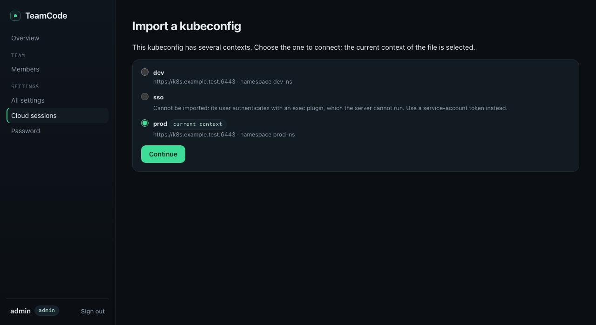
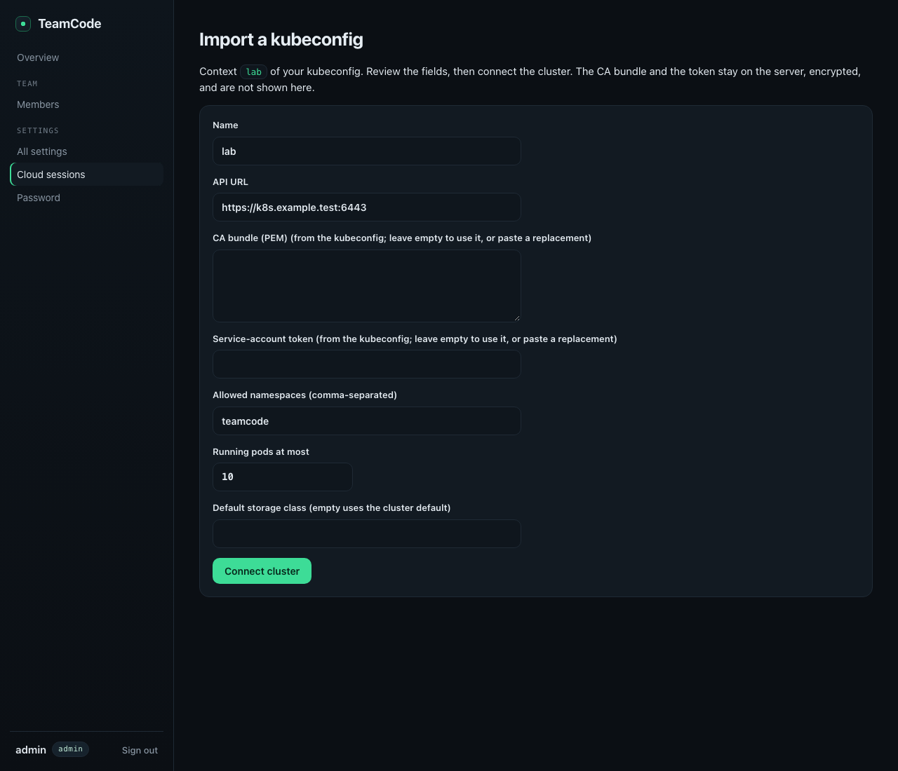

# Cloud agent sessions (V2)

TeamCode V2 runs agent sessions on a Kubernetes cluster that an administrator connects to the team. A session is a durable, logical identity: it survives pauses, pod replacements and server restarts, and keeps one workspace volume for its whole life. The CLI and the API share the same contract; the CLI never talks to Kubernetes.

This page is the contract and the record of what is implemented. It follows the [roadmap](roadmap.md) section on Kubernetes cloud sessions and builds on [stateless replicas](replicas.md), [audit](audit.md) and [service credentials](service-keys.md).

## Status

| Part | State |
| --- | --- |
| Domain model, states and transition table | Implemented (PR 1) |
| `TransitionCloudSessionUseCase`: compare-and-set on `generation`, epoch advance with its execution row | Implemented (PR 1) |
| Leased reconciler, capacity admission (FIFO), pause/checkpoint, lost-execution handling, retention expiry | Implemented (PR 1), against the `ClusterPort` interface |
| Proven workspace deletion (claim and provider volume), `Retain` refusal and alert, orphan garbage collection | Implemented (PR 1), against the `ClusterPort` interface |
| Runner channel (register, heartbeat, checkpoint) with epoch fencing, authenticated by `TokenReview` | Implemented (rules in PR 1, routes in PR 2) |
| MySQL tables and migration: clusters, versioned profiles, assignments, sessions, labels, executions, idempotency; audit attribution columns | Implemented (PR 1) |
| Management API: settings, clusters, profiles, sessions create/list/get/executions/pause/resume/delete, `TeamCode-On-Behalf-Of` for interactive administrators, `Idempotency-Key` | Implemented (PR 1), typed client included |
| Dashboard page for cloud settings (`/dashboard/cloud`): on/off, runner image, clusters, retention and transfers; profiles listed | Implemented (PR 1; runtime and clusters added later) |
| Server wiring (reconciler, garbage collection and maintenance workers), `cloud.sessions.v1` advertised while cloud sessions are on in the stored [runtime](#runtime-on-off-runner-image-and-pod-callback) | Implemented (PR 2; runtime moved from deployment variables to the dashboard) |
| Kubernetes adapter (pods, claims, volumes, storage classes, TokenReview) | Implemented (PR 2) |
| Runner skeleton `teamcode cloud runner` (register, heartbeat, checkpoint; no agent) | Implemented (PR 2) |
| CLI `teamcode cloud create/list/show/pause/resume/delete` | Implemented (PR 2) |
| Opt-in `kind` smoke (`scripts/smoke-cloud-kind.py`) | Implemented (PR 2), not part of pull-request CI |
| Ownership transfer: offers and administrator transfers, recipient rechecks, owner change at a paused boundary, revocation, settings (`cloud.transfer.v1`) | Implemented, see [transfer](#transfer) |
| `tcex_` inference credential per execution, the runner's loopback inference proxy (`cloud.inference.v1`) | Implemented, see [inference](#inference-from-the-pod) |
| Idle pause (turns, waiting messages and attachment leases), `initialMessage` on create (`cloud.sessions.initial-message.v1`) | Implemented, see [idle pause](#idle-pause) and [create](#create-request-and-view) |
| The agent in its own container under its own UID, the exec supervisor and the credential socket | Implemented, see [the runner and the pod](#the-runner-and-the-pod) |
| Environment preparation: recipe on the profile version and the session, repositories, working directory, Git identity, setup commands, progress and failures in the lifecycle, `cloud.environment.v1` | Implemented (PR 3) |
| Environment variables from environment variants | Implemented (PR 3, source wired in PR 3c) |
| [GitHub access](#github-access): team GitHub App configuration, member linking (`teamcode github link`, dashboard), encrypted user-token store, serialized refresh, unlink, `GitHubAccessSource` on that store, `github.link.v1` | Implemented (PR 3b) |
| Team MCP servers (through the runner's loopback relay), pinned skills and, for Claude Code, team hooks (installed under the agent's UID), resolved for the current owner at every agent start | Implemented, see [team MCP servers and skills](#team-mcp-servers-and-skills) |
| Transcript, messages, attach, personal and administrator keys | Implemented (#9, #21) |

The server advertises `cloud.sessions.v1` only while cloud sessions are on in the stored [runtime](#runtime-on-off-runner-image-and-pod-callback); while they are off, the routes that start new work answer `404` (see below). Clients must check that capability before using any route below.

## Resources

| Resource | Table | Owner | Purpose |
| --- | --- | --- | --- |
| Runtime | `cloud_runtime` | Administrator | Whether cloud sessions run, runner image and binary, callback origin for pods, workspace access mode; one row for the server's team, no credential |
| Cluster | `cloud_clusters` | Administrator | API URL, CA bundle, encrypted service-account credential, allowed namespaces, `maxRunningPods`, default storage class, garbage-collection report |
| Profile | `cloud_profiles`, `cloud_profile_versions`, `cloud_profile_assignments` | Administrator; assigned to members (yes/no) | Versioned, immutable once published: cluster, namespace, image, `allowedImageOverrides`, `imagePullSecrets` names, resources, workspace size and storage class, agent kind/version, idle timeout and bounds, [environment recipe](#environment-preparation) |
| Session | `cloud_sessions`, `cloud_session_labels` | Effective member (`ownerId`) | Pinned profile version, image and digest, resolved environment recipe, desired state, state/phase, `generation`, `currentEpoch`, labels, activity, resume quality, expiry, workspace and its deletion proof |
| Execution | `cloud_executions` | Session | One pod lifetime, unique on `(session_id, epoch)`: pod name, node, image digest, registration, heartbeats, exit reason, checkpoint result |
| Inference credential | `cloud_inference_credentials` + `tokens` | Execution; the member it runs for | A `tcex_` token limited to inference, the owner's MCP gateway, skill and hook delivery (`inference`, `mcp`, `skills:read`, `hooks:read`), stored as a SHA-256 digest in `tokens` and linked to its `(session, epoch)`; deleted when the execution ends |
| Idempotency record | `cloud_idempotency` | Team + initiating member | The session created by a keyed request, kept 24 hours |
| Transfer | `cloud_transfers` | Session; former owner and recipient | From, to, initiator and decider, state, resume and pending-input policy, the last epoch of the former owner and the transcript event of the change. Kept after completion |

| GitHub App | `github_apps` | Administrator | App id, client id, slug and name; client secret and private key encrypted, bound to the team |
| GitHub link | `github_links`, `github_link_attempts` | Member | The member's GitHub account (id, login) and App user tokens, encrypted and bound to the team and member; pending device or web links, single-use, encrypted and bound to the attempt and member |

Each execution row also records the owner it ran for (`owner_id`), which is how history stays attributed after a transfer.

Credentials are never stored in these tables, except the cluster's service-account token, the GitHub App's client secret and private key, and members' GitHub tokens and pending device codes, all encrypted with the server's credential key and bound to their row. No API returns them.

Groups do not exist in TeamCode yet, so profiles are assigned to members. Administrators may use every profile.

## Session states

`state` is a closed, stable enum. `phase` is an open, informational string; clients must tolerate unknown values.

| State | Meaning | Typical `phase` values |
| --- | --- | --- |
| `creating` | Accepted; waiting for capacity, provisioning the workspace and pod | `scheduling`, `waiting_capacity`, `starting_runner` |
| `preparing` | The runner registered for the first execution and is preparing the environment | `starting_runner` |
| `ready` | Prepared; accepts work | - |
| `active` | An agent turn is running (planned with the agent) | - |
| `pausing` | Draining and checkpointing | `draining`, `checkpointing`, `stopping_pod` |
| `paused` | No pod; workspace retained | - |
| `resuming` | A new execution is starting on the same workspace | `waiting_capacity`, `scheduling`, `starting_runner`, `restoring` |
| `transferring` | Changing owner at a paused boundary: no pod, recipient rechecked, then one transaction changes the owner | `transferring`, `stopping_pod` |
| `terminated` | Deleted or expired; no pod; workspace being deleted or deleted | `cleanup_pending`, `deleting_volume`, `cleaned` |
| `failed` | Unusable; the workspace never held work or is lost | - |

Other fields: `desiredState` (`running`, `paused`, `terminated`), `failure` and `resumeBlocked` (`{code, message, retryable}`), `resume` (`workspace`: `consistent`, `crash_consistent` or `lost`; `conversation`: `resumable`, `transcript_only` or `none`; always `none` until the agent lands), and `workspaceDeletion` (see [deletion](#workspace-and-proven-deletion)).

### Transitions

| From | To | Trigger |
| --- | --- | --- |
| (new) | `creating` | `POST /cloud/sessions` |
| `creating` | `preparing` | The runner registered for the current epoch |
| `creating`, `preparing` | `failed` | Missing or retaining storage class, namespace no longer allowed on the cluster, image or start failure, 15-minute start timeout, failed environment preparation (`preparation_failed`), 30-minute preparation timeout, or execution lost during the first execution. The workspace is deleted right away. |
| `preparing`, `resuming` | `ready` | The runner reported ready on a heartbeat. The agent is never reported ready earlier. |
| `ready`, `active` | `pausing` | Desired state `paused` (explicit pause, an accepted [transfer](#transfer), or the [idle pause](#idle-pause)), or the runner's checkpoint arriving before the reconciler's own move |
| `pausing` | `paused` | Checkpoint completed (`consistent`), or failed, missed heartbeats or 15-minute pausing deadline (`crash_consistent`) |
| `ready`, `active`, `pausing` | `paused` | Execution lost: no heartbeat for 90 s, the pod disappeared or stopped, or the execution row is missing (`execution_missing`, after deleting any pod of the session). `crash_consistent`, and the desired state becomes `paused`, so a lost execution never restarts by itself. |
| `paused` | `resuming` | Desired state `running` (explicit resume, or a [message](cloud-conversations.md#messages-and-interrupts) with `wake`) |
| `resuming` | `paused` | Image unavailable, start failure or timeout, failed environment preparation or 30-minute preparation timeout once the runner registered, lost execution, namespace no longer allowed, or a pause requested during the resume. Sets `resumeBlocked`, keeps the workspace, never `failed`. |
| `resuming` | `failed` | The workspace claim is lost |
| `paused` | `transferring` | An accepted transfer (`transferId` set) once the session is paused |
| `transferring` | `paused` | Owner changed without `resume`, or the transfer failed or was dropped (the session keeps its former owner) |
| `transferring` | `resuming` | Owner changed with `resume`: the next execution starts for the recipient |
| any | `terminated` | `DELETE`, or retention expiry while paused. A `failed` session keeps its deletion progress (a workspace already proven deleted stays proven). |

The table lives in `CloudStateMachine`; every write is checked against it.

## Coordination across replicas

API routes only write the desired state. A **leased reconciler** running on any replica does all cluster work, outside any database transaction:

- **Compare-and-set.** Every change is an Exposed conditional update `WHERE id = ? AND generation = ?` that increments `generation`. A lost race re-reads the row and evaluates the decision again (`TransitionCloudSessionUseCase`).
- **Lease per session.** `reconcile_owner`/`reconcile_until` use the database clock. A pass claims up to 8 due sessions with a 60 s lease; a session not reached within half the lease is released due immediately instead of being worked on with a lease about to expire. Reconciler writes also require the lease to still be held, so a stale owner whose lease expired cannot commit, and cannot release its successor's lease. A write made during a pass (for example a pause request) sets `reconcile_requested`, and the lease release schedules another pass immediately.
- **Epoch fencing.** Starting an execution advances `currentEpoch` by one and inserts the `cloud_executions` row in the same transaction, serialized on the cluster row with the capacity check. The `(session_id, epoch)` key and the generation check make a duplicate start impossible, even with two replicas holding the same stale view. The pod name is deterministic (`tc-<session>-e<epoch>`); creating an existing pod succeeds. Pods of older epochs are deleted and confirmed gone before the next epoch starts.
- **Runner fencing.** Every runner call is bound to `(session, epoch)` and to the pod name of the execution. Anything else returns `409 execution_fenced`; the runner must then stop its agent and exit without checkpointing.
- **Image pulls.** `InvalidImageName` and `ErrImageNeverPull` fail the start at once. `ErrImagePull` and `ImagePullBackOff` are retried by the kubelet (registry outage, rate limit, tag pushed late), so they fail the start only after 5 minutes.
- **Errors.** A step that throws (cluster or database unavailable, or a defect) is retried after 30 s; the reconciler takes an error callback so the server logs and counts it, and the raw error never reaches the session or its API view.
- **Bare pods.** A Job controller could recreate a pod outside TeamCode's epoch control, so the adapter creates bare pods with `restartPolicy: Never`; the reconciler alone decides whether to start again.
- **Exclusive volume.** The workspace claim requests `ReadWriteOncePod` by default, so the cluster itself refuses a second pod on the workspace. The runtime's workspace access mode `ReadWriteOnce` is for drivers without it (the local `kind` provisioner); the epoch rule above still applies.

Due times: about 2 s while a step is in progress, 5 s while waiting for capacity, 15 s while running (heartbeat watch), the expiry time while paused, 10 minutes while a deletion is blocked, and nothing once a deletion is proven.

## HTTP API under `/api/v1/cloud`

### Principals and the effective member

| Principal | Cloud rights in this release |
| --- | --- |
| Member (interactive login) | Own sessions; assigned profiles |
| Administrator (interactive login) | Every team session; clusters, profiles and settings |
| Service key without a cloud scope | None |
| Key with `cloud:read` | Its owner's sessions, executions, transcript, inputs and transfers, and the profiles the owner can use: `GET` only |
| Key with `cloud:write` | Everything in `cloud:read`, plus creating, pausing, resuming and deleting the owner's sessions, messages, interrupts, attachments and transfers |
| Administrator's key with `team:read` | Read-only: every member's sessions (`owner=all`), details, executions, transcripts, inputs, live stream and transfers; no write and no `TeamCode-On-Behalf-Of` |
| Administrator's key with `admin:cloud` | Everything in `cloud:write` with an administrator's rights over every team session and transfer, including `TeamCode-On-Behalf-Of` |
| Runner | `/api/v1/cloud/runner/*` only, for its own session and epoch, with its projected pod token |
| Execution credential (`tcex_`) | `inference`, `mcp`, `skills:read` and `hooks:read` as the member the execution runs for (never usage, publication, cloud or interactive routes); issued to the runner, never to a person |

`TeamCode-On-Behalf-Of: <memberId>` sets the effective member. It is accepted only from an interactive administrator or an administrator's `admin:cloud` key. On any other credential the header must be absent or equal to the caller's own id; otherwise `403 on_behalf_forbidden`. The target must be an enabled team member who completed password setup (`422 invalid_effective_member`), and for creation it must hold the profile assignment. The header never grants rights: the call is authorized with the caller's own rights.

For creation, the effective member becomes the owner; the retained-session cap and profile assignment resolve for that member.

### Attribution and audit

Sessions record `createdBy {initiatorId, credentialId, effectiveMemberId}`; `credentialId` is the id of the login session or key, never its token. The audit journal gained two nullable columns, `effective_member_id` and `credential_id`, exposed as optional fields of `GET /api/v1/audit` events. Journaled actions: `cloud.session.created`, `.paused`, `.resumed`, `.deleted` (by the caller), and `.pausing`, `.paused_checkpoint`, `.ready`, `.ready_resumed`, `.execution_lost`, `.resume_blocked`, `.failed`, `.expired`, `.terminated`, `.workspace_deleted` (by `system`, with the owner as effective member); `cloud.cluster.saved`, `cloud.profile.saved`, `cloud.settings.updated`, `cloud.runtime.updated`, and `cloud.runtime.seeded` (by `system`, see [runtime](#runtime-on-off-runner-image-and-pod-callback)). Transfers add a third nullable column, `related_member_id` (`relatedMemberId` in the API): `cloud.transfer.offered`, `.requested`, `.accepted`, `.declined`, `.cancelled` (by the caller, subject the transfer), `.started` (the session enters `transferring`), `.expired`, `.failed` (by `system`, with the recipient as effective member and the former owner as related member), and `cloud.session.transferred` (subject the session, actor the transfer's initiator, effective member the recipient, related member the former owner). For transfer entries, `effectiveMemberId` is the member the action was done for (the delegated member of an on-behalf call, otherwise the actor; the recipient for system entries) and `relatedMemberId` is the other member concerned, so filtering the journal by member finds every transfer that gave a session to or took one from them. The dashboard audit page shows both.

### Idempotency

`POST /cloud/sessions` requires `Idempotency-Key` (1–128 characters from `[A-Za-z0-9._:-]`). Scope: team + initiating member + route. The server stores a SHA-256 of the canonical request (the decoded body with sorted labels, plus the effective member) in the same transaction as the session:

- same key, same request: `202` with the session and `Idempotency-Replayed: true`;
- same key, different request or effective member: `422 idempotency_conflict`;
- concurrent requests with one key are serialized on the member row; one creates, the others replay.

The replay returns the **current** view of the created session rather than a byte copy of the first response. Records expire after 24 hours (bounded purge).

Pause, resume and delete are naturally idempotent through the desired state. Messages take `Idempotency-Key` or its `clientMessageId` alias ([messages](cloud-conversations.md#messages-and-interrupts)). `POST /cloud/sessions/{id}/transfer` requires `Idempotency-Key`, with the same scope and digest rules as creation (the digest covers the session, the body and the effective member); accept, decline and cancel are idempotent through the transfer's state.

### Routes

| Route | Purpose | Authorization | State |
| --- | --- | --- | --- |
| `GET/PUT /cloud/runtime` | [Runtime](#runtime-on-off-runner-image-and-pod-callback): on/off, runner image, callback origin; reachable while cloud sessions are off | Administrator | Implemented |
| `GET/PUT /cloud/settings` | Persistent settings | Administrator | Implemented |
| `GET/POST /cloud/clusters`, `PUT /cloud/clusters/{id}` | Clusters; `PUT` requires `version`; omitted CA/token keep the stored values, except when the API URL changes: the CA and a token for the new server are then required (`400 cluster_credentials_required`). The API URL is trusted administrator input: `https` only, loopback (`kind`) and private addresses allowed, link-local, unspecified and cloud metadata hosts refused (`400 cluster_host_not_allowed`). Numeric spellings (decimal, hex, octal, IPv4-mapped IPv6) are decoded before the check, and a DNS name is re-resolved whenever the connection is loaded: if any answer is link-local, unspecified or a metadata address the adapter refuses to send the token (`ClusterHostNotAllowedException`). The resolved address is not pinned for the connection itself. A namespace removed from a cluster is refused for new sessions (`409 namespace_not_allowed`) and blocks the start of existing ones | Administrator | Implemented |
| `GET /cloud/profiles` | Profiles assigned to the caller (all for administrators) | Member, administrator | Implemented |
| `POST /cloud/profiles`, `PUT /cloud/profiles/{id}` | Publish a new immutable version; `version` is the version being replaced | Administrator | Implemented |
| `POST /cloud/sessions` | Create; `202` | Member, administrator; owner = effective member | Implemented |
| `GET /cloud/sessions` | List: own sessions; `?owner=<id>` or `?owner=all` for administrators; `state` and `label=k=v` (repeatable) filters; `before=<sessionId>` cursor; `limit` ≤ 50 | Member, administrator | Implemented |
| `GET /cloud/sessions/{id}` | Read | Owner, administrator | Implemented |
| `GET /cloud/sessions/{id}/executions` | Pod history: epoch, node, digest, exit reason, checkpoint | Owner, administrator | Implemented |
| `POST /cloud/sessions/{id}/pause` | `{force?: false}`; `202`. `409 session_preparing` while creating or preparing; repeated pauses write nothing | Owner, administrator | Implemented |
| `POST /cloud/sessions/{id}/resume` | `202`; `409 session_pausing` while a pause is still draining; synchronous recheck that the owner is enabled and still assigned to the profile (`403 owner_unavailable`, `403 profile_unassigned`) | Owner, administrator | Implemented |
| `DELETE /cloud/sessions/{id}` | Terminate and delete the workspace; `204`, also when already terminated | Owner, administrator | Implemented |
| `POST /cloud/runner/register`, `.../heartbeat`, `.../checkpoint` | Runner channel: `{teamId, sessionId, epoch}` (plus `ready` or `completed`); returns `{desiredState, pauseDeadline, epoch}`. `401 runner_unauthenticated`, `409 execution_fenced` | Pod token (`TokenReview`) | Implemented |
| `POST /cloud/runner/github` | `{teamId, sessionId, epoch}`; returns `{status, token, expiresAt}` (`linked`, `not_linked` or `unavailable`) for the member the current execution runs for, `Cache-Control: no-store`, with `cloud.github.v1`. Only the registered runner of a running execution of the current epoch (`409 execution_fenced` otherwise, `409 github_unavailable` when the session is not in a state that runs); after a transfer the recipient's token, never the former owner's. The environment route returns the token once for preparation; this renews it for the credential helper. |
| `POST /cloud/runner/inference` | `{teamId, sessionId, epoch}`; returns `{token, expiresAt}`, a `tcex_` inference credential for the execution's member, `Cache-Control: no-store`. Only the registered runner of the current epoch, while the session is `preparing`, `resuming`, `ready`, `active` or `pausing` (`409 execution_fenced`, `409 inference_unavailable`) | Pod token (`TokenReview`) | Implemented |
| `POST /cloud/runner/environment` | The recipe, the owner's Git identity, variable values and GitHub token for this execution (`Cache-Control: no-store`). Only the registered runner of the current epoch, while `preparing` or `resuming`; otherwise `409 not_preparing`. Missing required variables or GitHub access: `409 preparation_failed` | Pod token | Implemented |
| `POST /cloud/runner/preparation` | `{phase}` progress, or `{phase, failure: {step, index, exitCode}}`; returns the instruction | Pod token | Implemented |
| `/cloud/sessions/{id}/events`, `.../events/stream`, `.../messages`, `.../interrupt`, `.../attachments`, `/cloud/access`, `/cloud/runner/agent`, `.../events`, `.../inputs` | Transcript, messages, interrupt, attach lease, access policy, agent channel: see [transcript, messages and attach](cloud-conversations.md) | Access policy | Implemented |
| `/cloud/events/stream` | Caller-wide SSE feed | | Planned |
| `POST /cloud/sessions/{id}/transfer` | `{toMemberId, resume?, force?}` with `Idempotency-Key`; `202`. An administrator's transfer is `accepted` at once, an owner's is `offered` | Owner (when `memberTransfers` is `offer`), administrator | Implemented |
| `GET /cloud/transfers` | `direction=incoming\|outgoing\|all`, `scope=team` (administrators), `state` (repeatable), `session`, `before`, `limit` ≤ 50 | Both members, administrator | Implemented |
| `GET /cloud/transfers/{id}`; `POST .../accept` (`{resume?}`), `.../decline`, `.../cancel` | Read and decide | Recipient (accept, decline), former owner (cancel an offer), administrator (all) | Implemented |

While cloud sessions are off, the requests that start new work answer `404` after authentication: creating a session, resuming, sending a message, attaching, offering or accepting a transfer, and starting a GitHub link (device flow start and web flow; the callback, which authenticates itself, completes a link started while cloud sessions were on), whatever the path spelling (the gate reads the path the way routing matches it). Reading, pausing, interrupting and deleting sessions, renewing an existing attachment, declining or cancelling transfers, unlinking GitHub, configuration and the runner channel stay available, so existing sessions can always be stopped and running pods keep their channel. No new pod starts while they are off: a session still queued waits until they are on again, and queued messages do not wake paused sessions. Routes that authenticate themselves (the runner channel, the GitHub callback) are never gated, so an anonymous caller cannot learn whether cloud sessions are on. A session the caller cannot see returns `404`. Errors use the existing `ApiError {error: {type, message}}`.

### Create request and view

```json
POST /api/v1/cloud/sessions
Idempotency-Key: task-1234-create
TeamCode-On-Behalf-Of: 6f1c...member-uuid

{
  "name": "Task 1234: fix relist retry",
  "profileId": "b2d0...uuid",
  "image": null,
  "agent": { "model": "opus", "effort": "high" },
  "labels": { "orchestrator.task": "1234" },
  "idleTimeoutMinutes": 30,
  "environment": {
    "repositories": [{ "url": "https://github.com/example/api.git", "path": "api", "ref": "main", "branch": "task-1234" }],
    "workingDirectory": "api"
  },
  "initialMessage": "Fix the relist retry, see task 1234."
}
```

- `image` must equal the profile image or match one of its `allowedImageOverrides` (`*` matches any run of characters, everything else is literal); otherwise `403 image_not_allowed`.
- `labels`: at most 16 pairs, lowercase keys up to 63 characters, values up to 256, not secret, filterable.
- `idleTimeoutMinutes` is clamped to the profile bounds set by the administrator (`minIdleTimeoutMinutes`..`maxIdleTimeoutMinutes`, at most 1,440); the profile's `idleTimeoutMinutes` applies when it is omitted. See [idle pause](#idle-pause).
- `agent.model` and `agent.effort` are recorded; they are checked against the member's model policy on every inference, as for local sessions.
- `environment` (with `cloud.environment.v1`) replaces the profile's `repositories` and `workingDirectory` for this session; setup commands, required variables and the other recipe fields come from the profile only. Null fields keep the profile's values.
- `initialMessage` (capability `cloud.sessions.initial-message.v1`): the first message for the agent, same rules as `POST .../messages` (1 to 32,000 characters, no control characters except newlines and tabs). It is queued with the session and delivered once the session is `ready`, written by the caller: an administrator creating on behalf of a member is its author, and needs the `message` permission on that member's sessions. It is part of the request digest, so a replay with the same `Idempotency-Key` queues nothing more, and a failure between the session and the message is repaired by that replay (the message wakes the session like any message, so a session paused meanwhile resumes for it; a replay whose rechecks now fail, for example a revoked `message` permission, leaves the session without it). A server with cloud sessions but without conversations refuses it with `400 initial_message_unsupported`. The creation body may be up to 256 KB.
- The server ignores unknown fields, so do not send `environment` or `initialMessage` before the matching capability is advertised.

The response is the session view: `id`, `name`, `ownerId`, `createdBy`, `state`, `phase`, `desiredState`, `generation`, `currentEpoch`, `profile {id, version}`, `image {reference, digest}`, `agent {kind, version, model, effort}`, `labels`, `activity {lastActivityAt, idleTimeoutMinutes}`, `resume`, `failure`, `resumeBlocked`, `workspaceDeletion`, `createdAt`, `updatedAt`, `pausedAt`, `expiresAt`, `terminatedReason`, `environment` (the resolved recipe). The image digest is recorded from the first running container; every later execution uses `reference@digest`, so a moved tag does not change a resumed session.

### Bounds and capacity

- Settings `maxRunningSessionsPerMember` (default 2) and `maxRetainedSessionsPerMember` (default 20) apply to every member; per-member overrides in member policy are planned.
- Each cluster has `maxRunningPods`. Executions not yet ended count, for all sessions on the cluster.
- A creation or resume beyond the running caps waits in `creating`/`resuming` with `phase = waiting_capacity`. Admission is FIFO per cluster: an older waiting session goes first unless its owner is at their own cap.
- The retained cap (sessions neither terminated nor failed) is enforced synchronously: `409 cloud_session_limit`.
- Inference from a pod uses the existing ledger, routing and pacing, under the member the execution runs for (see [inference](#inference-from-the-pod)). Pod-hours are not metered as quota.

## Persistent settings

Administrators edit them through `PUT /api/v1/cloud/settings` or **Dashboard → Cloud sessions** (`/dashboard/cloud`), like the `experimentalCrossProviderTranslation` model setting. They live in `cloud_settings`; a team without a row uses the defaults.

| Setting | Default | Meaning |
| --- | --- | --- |
| `pausedRetentionDays` | 30 | Days a paused session keeps its workspace. `null` keeps it indefinitely. |
| `failedWorkspaceRetentionDays` | 7 | Days a session that failed after its first execution keeps its workspace. |
| `maxRunningSessionsPerMember` | 2 | Running cap per member. |
| `maxRetainedSessionsPerMember` | 20 | Retained cap per member. |
| `transcriptRetentionDays` | 30 | Days transcript events are kept (1 to 3,650). `null` keeps them indefinitely. |
| `memberTransfers` | `offer` | `offer`: an owner may offer their own session and the recipient accepts; `disabled`: only administrators transfer. |
| `transferOfferDays` | 7 | Days a recipient has to accept an offer (1 to 30). |
| `transferPendingInputs` | `cancel` | Messages not yet consumed when the owner changes: `cancel` (reason `transferred`) or `keep` (delivered to the recipient's next execution). |

In `PUT /cloud/settings`, an absent transfer field keeps its stored value, so a client written before transfers existed does not reset the transfer policy; responses always carry all three.

`expiresAt` is computed when the session pauses, from the setting in force at that moment; changing the setting applies to sessions paused afterwards, so shortening it never deletes existing work by surprise. Resuming clears it. At expiry the session is terminated with reason `expired` and its workspace deleted as below. The 7-day and 1-day expiry notices need the transcript and feed, and are planned.

The pause before a change of owner and the end of the former owner's access are not settings: they are what makes a transfer safe (see [transfer](#transfer)). The pending-input policy is copied onto the transfer when it is accepted, so a later change of the setting does not alter a transfer in progress.

## Workspace and proven deletion

Each session has one PersistentVolumeClaim, `tc-ws-<session>`, created before its first pod, kept while paused, and deleted at the end. Deleting a claim is not enough: the provider volume behind it (for example an OpenStack Cinder volume) must be gone too.

- **Refusing retention.** Publishing a profile checks the workspace storage class on the cluster and refuses one whose `reclaimPolicy` is not `Delete` (`422 storage_class_retains_volumes`), or a missing one (`422 storage_class_missing`). The reconciler checks again before creating a claim and fails the session with the same code, since the class can change after publication.
- **Proof.** When a session ends, the reconciler records the bound PersistentVolume name and the provider volume handle (for CSI volumes, `spec.csi.volumeHandle`), deletes the claim, waits until the claim is gone, then waits until the PersistentVolume is gone. With `reclaimPolicy: Delete`, the external provisioner removes the PersistentVolume only after the driver's `DeleteVolume` call succeeded on the provider, so its disappearance is the proof that the provider volume was deleted. `workspaceDeletion.state` becomes `proven` with `claimDeletedAt` and `volumeDeletedAt`; the handle stays on the session as evidence, and `cloud.session.workspace_deleted` is journaled.
- **Alerts.** A volume found with a non-`Delete` policy, in phase `Failed`, or still present one hour after its claim was deleted marks the deletion `blocked` with `volume_retained` or `volume_deletion_stalled`, rechecked every 10 minutes. The administrator deletes the provider volume and the PersistentVolume; the next check then proves the deletion.
- **Garbage collection.** For each cluster, a pass lists TeamCode-labelled pods and claims (`app.kubernetes.io/managed-by=teamcode` and the cluster id label, so another cluster record or server sharing a namespace is never touched) in the allowed namespaces and in any namespace that still holds a session not yet proven deleted, and the released or failed volumes of TeamCode workspaces, before reading which claims and current-epoch pods the database still accounts for. Objects are created only after their row commits, so this order never mistakes a fresh object for an orphan. Orphaned pods and claims are deleted; orphaned volumes (claim in one of those namespaces) that would not be deleted by their provisioner are counted in the cluster's `orphanedVolumes`, with `lastGarbageCollectionAt`. A scheduled worker runs it every 10 minutes on one replica.
- **Acceptance.** `CloudSessionPersistenceTest` verifies that no claim or volume remains after deletion with a fake cluster that models the provisioner. `KindSmokeTest` verifies it on a real cluster through the Kubernetes adapter; on OpenStack, the recorded handle can also be checked with `openstack volume show`.

## Pause and resume

1. `POST /pause` sets `desiredState = paused`. The reconciler moves `ready`/`active` to `pausing`; a checkpoint the runner sends first (it learns of the pause from its heartbeat) is accepted and makes the same move.
2. The runner's heartbeat response carries `desiredState` and `pauseDeadline` (10 minutes after the request, or immediate with `force: true`). The runner drains, stops its child processes, writes its checkpoint and calls `checkpoint {completed}`.
3. The reconciler deletes the pod, confirms its deletion, ends the execution and marks the session `paused` with `consistent`.
4. A failed checkpoint, missed heartbeats or the 15-minute pausing deadline force-delete the pod: `paused` with `crash_consistent`. It is never advertised as `consistent`.
5. `POST /resume` rechecks the owner and assignment, then sets `desiredState = running`. The reconciler moves the session to `resuming`, waits for capacity, starts epoch n+1 on the same workspace with the pinned digest, and the runner's ready heartbeat makes it `ready`.

### Idle pause

A session that wants to run is paused after `idleTimeoutMinutes` without activity. Activity is:

- the last turn start or end, and the moment the session became `ready` (`activity.lastActivityAt`);
- a message or interrupt waiting for the agent (queued or delivered, not yet acknowledged), from when it was queued or last delivered: it counts once, not forever, so an input stuck on a broken runner does not keep a session running;
- an attachment lease: a member attached with `teamcode cloud attach` (or any client holding a lease) keeps the session running, and the end of the lease (detach or expiry) counts as the last activity.

Only a `ready` session is a candidate: a turn in progress (`active`), a preparation, a resume or a transfer never is. The reconciler checks on its monitoring pass (every 15 s), reads leases and inputs only when the session row already looks idle, and commits an ordinary, non-forced pause (`desiredState = paused`, audit action `cloud.session.idle_paused`), so the session checkpoints and keeps its workspace. A message with `wake` (the default) resumes it.

The administrator sets the timeout per profile: the default `idleTimeoutMinutes` and the bounds a member may choose within (`minIdleTimeoutMinutes`, `maxIdleTimeoutMinutes`, 5 to 1,440 minutes). Ended attachment rows are kept as long as the longest timeout (a day), then purged with the transcripts.

Inactivity only pauses; it never deletes. The idle warning and `maxTurnMinutes` are planned.

## Transfer

A session can change owner and keep its identity, workspace, transcript and executions. Capability `cloud.transfer.v1`.

### Who may transfer

- **Administrators** transfer any team session to any eligible member at once: the transfer is created `accepted`. With `TeamCode-On-Behalf-Of`, the delegated member is recorded as the transfer's effective member; the call is still authorized with the administrator's rights, as everywhere else. An administrator's transfer cancels a pending offer for the same session (`superseded`).
- **An owner who is not an administrator** can only offer their own session (`offered`), and only while `memberTransfers` is `offer`. The recipient, or an administrator, accepts or declines it within `transferOfferDays`; the owner can withdraw it until it is accepted. Switching `memberTransfers` to `disabled` also stops pending offers: a member can no longer accept one (`403 transfer_disabled`), an administrator still can. Acceptance keeps the offer's `resume` unless it sends one. Nobody can take a session they do not own: a member asking to transfer someone else's session gets `404`, and only the recipient or an administrator can accept.
- A session has at most one open transfer (`409 transfer_pending`). A session being created or prepared cannot be transferred (`409 session_preparing`): its preparation runs with the owner's credentials and recipe. An ended session cannot either (`409 session_not_running`).
- `POST /transfer` requires `Idempotency-Key`; a retry replays the transfer even after the session changed (`Idempotency-Replayed: true`).

Transfer states: `offered` → `accepted` → `completed`, or `declined`, `cancelled` (by a member, `superseded`, or because the session ended), `expired` (offers past their validity; a maintenance worker records it, and reads show such an offer as `expired` before it does), `failed` (the recipient was no longer eligible at the boundary, or `transfer_timeout`).

### Recipient checks

The recipient is checked when the transfer is requested, when it is accepted, and again by the reconciler right before the owner changes, on fresh data. A refusal at request or acceptance is `422 recipient_ineligible`, naming every problem code; a refusal at the boundary fails the transfer with that code and returns the session to `paused` for its former owner.

| Check | Code |
| --- | --- |
| A team member, enabled, password setup completed | `recipient_not_found`, `recipient_unavailable` |
| Assigned to the session's profile (administrators use every profile) | `profile_unassigned` |
| `create` under the [access policy](cloud-conversations.md#access), as for a creation on their behalf | `cloud_permission_denied` |
| The session's recorded agent model and effort against the team's model policy, exactly as inference will check them | `model_not_allowed`, `effort_not_allowed` |
| An inference allowance at all (a pool weight or daily allowance of zero refuses). Today's consumption is not checked: a transfer neither resets nor borrows allowances | `recipient_no_quota` |
| The retained-session cap, in the owner-change transaction under the recipient's member row lock | `cloud_session_limit` |

The checks are a list of `CloudRecipientCheck` ports. Environment variables, MCP servers and skills are delivered to cloud sessions by other branches (environment preparation, the MCP gateway and the skill catalog); their assignment checks (for example the profile's `requiredVariables` for the recipient) join this list when they are merged, without changing the transfer flow.

### The boundary: pause first, then change owner

**Decision.** The owner changes only at a paused boundary, never in a running pod. Accepting a transfer sets the desired state to `paused` (keeping `transferId` on the session); a running session drains and checkpoints exactly like an explicit pause (the running turn finishes, or is interrupted 60 s before the deadline; `force` pauses at once and leaves a crash-consistent workspace), the reconciler deletes the pod and confirms it is gone, and only a `paused` session moves to `transferring`. There, the reconciler deletes any pod of the session still listed by the cluster, ends any execution still open, rechecks the recipient, and commits the change in one transaction. The next execution is a new epoch, started for the recipient, by `resume` on the transfer (or the acceptance) or later by the recipient.

**Why.** Everything that acts for the owner inside a pod is bound to that pod or was resolved for the owner when it started: the agent process and its memory, the Git and GitHub credentials and the variable values the runner fetched for the owner, MCP credentials, and the pod's projected token. None of it can be proven revoked while the process lives, and the agent may have copied a credential into a child process. Ending the execution is the only revocation that holds, and the epoch fence already guarantees that nothing of an ended epoch can call the server again. The other options were set aside:

- *Live hand-off in the running pod* (rotate credentials, keep the process): the former owner's credentials stay in the process and its children, and the work in progress would be billed partly to one member and partly to the other within one turn.
- *Cancel the turn and transfer at once*: loses the running turn's work for no gain over `force`, which administrators can already ask for.
- *Refuse transfers of running sessions*: pushes the pause onto every caller (an orchestrator would have to pause, poll and transfer), with a race between the pause and someone resuming it.

The cost is the drain (bounded by the pause deadline) and one pod restart. The workspace, the transcript and, for agents that support it, the conversation (resumed by id) are kept, so the recipient continues the same session.

While a transfer is accepted and not finished, an explicit resume is refused (`409 session_transferring`), a message never wakes the session, and a new transfer is refused. Deleting the session cancels the transfer. `transferring` is bounded: the reconciler checks a 30-minute deadline, counted from the moment the session entered it (`cloud.transfer.started`), before any cluster call; past it (a cluster that never confirms the pod deletion), the transfer fails with `transfer_timeout` and the session returns to `paused` for its former owner, who can offer it again.

A message sent or an attachment requested by a member authorized against the former owner can race with the owner change: both lock the session row and refuse with `409 session_busy` when its owner is no longer the one they were authorized against, so nothing is queued or leased for the old owner after the change.

### What changes at the boundary

In the owner-change transaction:

- `ownerId` becomes the recipient; the transfer becomes `completed` with `atEpoch` (the last epoch run for the former owner) and `eventSeq`.
- Every attachment lease of the session is removed. The former owner's `attach` stops at its next renewal, and their transcript stream ends with `event: denied` at its next access check.
- Messages not yet consumed follow the transfer's `pendingInputs`: `cancel` marks them `cancelled` with reason `transferred` (each with its `input` transcript event), `keep` queues them for the recipient's next execution. Wake requests are cleared either way: with `keep`, a former owner's message is delivered to the recipient's agent when the recipient resumes the session (or at once with `resume`), but it never resumes the session by itself.
- A server-written `transfer` event `{transferId, fromMemberId, toMemberId, atEpoch}` is appended to the transcript.
- `cloud.session.transferred` is journaled with the initiator, the recipient and the former owner.
- Without `resume`, the session stays `paused` and its expiry restarts from the recipient's full paused retention. With `resume`, it moves to `resuming` and starts for the recipient.

After it, the former owner has no owner rights on the session (it is a `404` for them), unless the team's access policy grants them access to other members' sessions. The recipient sees the whole history.

### Former-owner credentials

- **Pod and execution.** No pod of the session exists after the boundary, and every execution of the former owner ended; their projected tokens are fenced by epoch. Their `tcex_` inference credentials were deleted when their execution ended (the pause before the boundary), and the owner-change transaction deletes any credential of the session again.
- **Git, GitHub and variables.** The environment branch resolves the Git identity, the GitHub user token and the variable values for the session's current owner on every runner `environment` call, which only the registered runner of the current epoch can make. After a transfer, that is the recipient's first execution. Nothing of the former owner's is stored with the session or in the pod spec. The runner's credential helper and `GH_TOKEN` live in memory and in child-process environments of the ended pod only.
- **Attachments.** Removed in the transaction.
- **Workspace content.** The workspace is transferred as it is: that is the point of a transfer. Files the former owner (or their agent) wrote there, including the agent's conversation state under `$HOME`, belong to the session. Credentials never reach the workspace through TeamCode, but a secret that a member typed into a file goes with the session.

### Attribution and billing

Each execution records the owner it ran for (`ownerId` in `GET /cloud/sessions/{id}/executions`). Work of an execution (inference through its `tcex_` credential, which is issued for `ownerId`, and pod time) is attributed to that member, so the former owner's executions stay theirs and the recipient's start at `atEpoch + 1`. Transcript events carry their epoch, and `message.user` events their author, so history remains attributable after the change. Usage already recorded in the ledger is never moved, and allowances are neither reset nor transferred.

## The runner and the pod

- **Pod.** One bare pod per execution, `tc-<session>-e<epoch>`, `restartPolicy: Never`, labelled `app.kubernetes.io/managed-by=teamcode` with the session, cluster and epoch. Non-root (GID/fsGroup 1000, `runAsNonRoot`), `seccompProfile: RuntimeDefault`, no privilege escalation, all capabilities dropped, `automountServiceAccountToken: false`, no service links, no shared process namespace. Two containers from the team image share the workspace claim (`/workspace`) and a memory-backed `emptyDir` at `/run/teamcode` that holds two sockets, and nothing else:
  - `session` is the runner, UID 1000 (`HOME=/workspace/.home`). It alone mounts the projected token and holds every server credential. It has fixed small resources (250m CPU, 256Mi).
  - `agent` runs the exec supervisor, UID 1001 (`HOME=/workspace/.agent-home`, which its UID creates on the volume so agent state survives pauses). It has no token, no server URL and no session identifier in its environment, and it gets the profile's CPU and memory requests and limits.
  The two UIDs must differ (`KubernetesPodOptions` refuses equal or root UIDs). Both are in group 1000, so the workspace is shared; the runner's own files are private to it. The pod's total resources are the profile's plus the runner's.
- **Delivery.** An init container from the runtime's runner image copies the `teamcode` Linux binary (the runtime's binary path, default `/usr/local/bin/teamcode`) into an `emptyDir` at `/opt/teamcode`, with `cp`; the `session` container runs `/opt/teamcode/teamcode cloud runner` and the `agent` container `/opt/teamcode/teamcode cloud agent-supervisor`; the copied file must be executable by other users (mode 0755 in the runner image), since the agent's UID runs it. The team image stays a pure toolchain (Linux with the published binaries' glibc baseline, `/bin/sh`, `git`, usable by UIDs 1000 and 1001), plus the agent CLIs; see the [image contract](#image).
- **Identity.** A projected ServiceAccount token, audience `teamcode`, 600 s expiry (the API minimum; the kubelet rotates the file, and the runner reads it for every call). The server reviews it with `TokenReview` using the cluster credential and requires the bound namespace to be the session's and the bound pod name to be the current execution's pod; the pod name always comes from the review, never from the request. A pod of the session with another epoch gets `409 execution_fenced` and exits. Reviews are cached 60 s per token (refusals 10 s, in a separate cache so bad tokens never evict accepted ones), so a heartbeat every 15 s costs one review a minute per pod. No TeamCode secret exists in the cluster, and the pod environment holds only the server URL, the token file path and the team, session and epoch identifiers.
- **Channel.** HTTPS only (the client refuses plain HTTP except on loopback): register, heartbeat every 15 s (the response carries the desired state and pause deadline), checkpoint; later batched event upload and an input long-poll. It fits stateless replicas with MySQL as the only bus and needs no inbound connectivity to the pod. Network failures are retried with backoff; the server marks the execution lost after 90 s without heartbeats.
- **Runner.** This release's runner starts no agent: it registers, [prepares the environment](#environment-preparation) while heartbeating, reports ready once prepared, and checkpoints immediately when a pause is requested (there is nothing to drain yet). It exits on `409 execution_fenced` or when the session is being deleted, retries any other `409` (for example a checkpoint refused because the pause was cancelled), and exits with code 2 on `401`. The client reads only the error code of a failed runner call, never its message.
- **Token exposure.** The projected token is mounted in the runner's container only, which the agent shares neither by mount nor by process namespace. The agent cannot call the runner channel (report a clean checkpoint, fetch a `tcex_` credential) and cannot read the runner's memory, environment or files.
- **Exec supervisor.** `teamcode cloud agent-supervisor` is the agent container's entrypoint. It listens on `/run/teamcode/agent.sock` (mode 0660, created under a narrowed umask so it is never wider) and starts what the runner asks for, as its own UID: the agent and, later, the environment preparation commands. The protocol is one JSON line per message on a connection per process: `start` (command, arguments, environment overrides with removals, directory), then `in`, `close` and `stop` from the runner and `out` and `exit` back; a failed start answers `error` and the runner sees exit code 127. A `hold` connection is the runner's lifeline: the supervisor stops every process and exits when it closes (so the pod ends when the runner does, whatever its exit code), and exits with 1 if the runner never connects within two minutes. A connection that drops stops its process. The runner retries the connection for a minute while the agent container starts, and never falls back to running the agent in its own container: when the socket is configured and unreachable, the agent does not start (`agent_start_failed`). Anything holding the socket's group can use it, which is only the two containers.
- **Credential socket.** The runner serves `/run/teamcode/credential.sock` (same mode). The agent container carries `GIT_CONFIG_*` variables that set `credential.helper` to `teamcode cloud credential`, which implements git's helper protocol: `get` sends the remote git describes (protocol, host, path) and prints the one credential the runner answers, `store` and `erase` do nothing, and without a socket, a host or a credential it prints nothing and succeeds so git moves on (`GIT_TERMINAL_PROMPT=0` keeps it from asking). The runner asks its token sources in order, each answering only for the hosts it owns, with a 15 s limit per request and at most 8 at once; a source that fails is logged without its message and skipped. The one source is GitHub: for `https://github.com` only, it returns `x-access-token` and the token of the member the current execution runs for, fetched with `POST /cloud/runner/github` when first asked and again five minutes before it expires, kept in the runner's memory only. Without a linked account it answers nothing (public repositories clone anonymously) and the server is not asked again for 30 seconds. `gh` needs a token in its own configuration and is not wired yet.
- **Planned.** A one-time Secret fallback where `TokenReview` is not permitted.
- **Kubernetes client.** The adapter (`KubernetesClusterPort`) calls the Kubernetes REST API with the Ktor client the server already uses, rather than fabric8 or the official Java client. The surface is small (pods, claims, volumes, storage classes, TokenReview), the server stores each cluster's URL, CA and token instead of a kubeconfig, and the adapter is tested with Ktor's mock engine. Each cluster gets its own client whose trust store holds only that cluster's CA bundle; the connection is reloaded from the database at most every 30 s, so a rotated token applies quickly. Lists are paged (500 per page, at most 20 pages, 200 for the cluster-wide PersistentVolume list); a page missing mid-list fails the call rather than passing for a complete list. Concurrent first uses of a cluster build one client, and a client replaced after a rotation stays open until shutdown for requests in flight. API error bodies are never kept or logged. It adds no dependency, and nothing reaches the native CLI, which keeps `cli -> client -> api`.

## Environment preparation

Toolchain and preparation are separate. The **image** carries what is installed (for example Node.js, a JDK, Gradle); the **recipe** says what to do with it in each session. Neither contains a TeamCode or provider credential.

### Image

- **Per profile, per session.** The profile names the image; a session may name another one only if it matches the profile's `allowedImageOverrides`. Private registries authenticate through the profile's `imagePullSecrets`, Kubernetes Secrets the administrator manages in the namespace; TeamCode never stores registry credentials.
- **Digest.** The digest of the first running container is recorded on the session (`image.digest`) and on the execution; every later execution starts `reference@digest`, so a resume prepares on the same bits even if the tag moved.
- **Template.** [Cloud session image](cloud-session-image.md) gives a Dockerfile that meets this contract, with one block for your tools; the same image can also be the runner image.
- **Contract.** Linux with the published binaries' glibc baseline, `/bin/sh` and POSIX `mkdir`, `rm`, `mv`, `rmdir`, `dirname`, `touch`, `test`; `git` 2.31 or later (credentials are configured through `GIT_CONFIG_COUNT`); the runtime libraries of the copied `teamcode` binary (`libcrypt.so.1`, `libcrypto` 3, libcurl, zlib), which both containers run; writable by UID 1000 and usable by UID 1001 (the agent); the agent CLIs (`claude`, `codex`) on `PATH`, installed outside any home directory. `gh` is optional. No TeamCode binary is required: the runner binary is copied in by the init container. [Cloud session image](cloud-session-image.md) details each point.
- **No baked identity.** Nothing in the pod spec identifies a member or a provider account: the pod environment holds only the server URL, the token file path and the team, session and epoch identifiers. Credentials reach the pod only through the runner channel, at preparation time, for the current owner.

### Recipe

The recipe is part of the immutable profile version (`spec.environment`). At creation, the session's `environment` overrides are merged in and the result is stored on the session (`cloud_sessions.environment`, JSON without any secret), so a resume prepares exactly what the first execution did, even after the profile changed. It is never edited afterwards.

| Field | Meaning |
| --- | --- |
| `repositories` | Up to 16 `{url, path, ref?, branch?}`. `https://` URLs without credentials, query or fragment; `path` relative to `/workspace` (not under `.teamcode` or `.home`, never nested in another repository); `ref` is a branch, tag or commit; `branch` is a local branch created at `ref`. Option-like and malformed refs are refused |
| `workingDirectory` | Relative to `/workspace`; must exist after cloning. Setup commands run there |
| `setup.create` | Up to 16 commands run once per workspace, in order, with `/bin/sh -c` |
| `setup.start` | Up to 16 commands run on every execution, after `create` |
| `requiredVariables` | Variable names the owner must be assigned; preparation fails without them |
| `requireGitHub` | Preparation fails when the owner has no usable GitHub access |
| `gitEmailDomain` | Email domain of the Git identity for owners without a linked GitHub account |
| `repositoryHosts` | Hosts repositories may be cloned from, `["github.com"]` by default; session repositories are checked against the profile's list, so a request cannot point the pod at metadata or cluster-internal endpoints |

A session that replaces the repositories while the profile's working directory is not inside any of them must set `workingDirectory` too (`400 invalid_environment`), rather than failing in the pod after a full clone.

### What the runner does

After registering, the runner prepares while it keeps heartbeating (`ready: false`), so a long clone or dependency install never looks like a lost pod:

1. `POST /cloud/runner/environment` returns the recipe and, resolved for the **current owner** on every call: the Git identity, the variable values and the GitHub token. A transferred session therefore never keeps its former owner's values.
2. **Git identity** (`configuring_git`): `git config --global user.name/user.email` under `HOME=/workspace/.home`, rewritten on every execution. A linked GitHub account gives `<login>` and `<id>+<login>@users.noreply.github.com`; otherwise the member name and `<name>@<gitEmailDomain>` (`users.noreply.teamcode.invalid` by default).
3. **Repositories.** If `/workspace/<path>/.git` exists, only `git fetch --prune origin` (`fetching_repositories`): work on the workspace is never reset or re-cloned. Otherwise (`cloning_repositories`) clone into `/workspace/.teamcode/clone-<n>`, check out `ref`, create `branch`, then move it into place; an interrupted clone is cleaned and retried, and a non-empty directory at the path is never overwritten.
4. The **working directory** must exist.
5. **Setup** (`running_setup`): each `create` command whose marker `/workspace/.teamcode/setup/create-<n>-<hash>.done` is missing (the hash is the command's, so an edited command runs again on a new session), then every `start` command.
6. The next heartbeat reports `ready: true`, and only then does the session become `ready`.

Command output goes to `/workspace/.teamcode/logs/prepare-e<epoch>.log` on the session's own workspace and never reaches the server, the pod log or the transcript. After each command the runner replaces known variable values and the token by `[REDACTED]` and keeps the last 4 MiB, rewriting the file atomically. Masking is best effort: a command that prints a credential (`env`, `set -x`) writes it to the log until the command ends, or for good if the pod dies first, and transformed values (base64, URL-encoded) are not recognized. Setup commands must not print credentials.

A runner error (unwritable or full workspace) is reported as step `runner` right away instead of waiting for the preparation timeout, and a runner that stops heartbeating while it prepares a resume is lost after 90 seconds, as during a first preparation.

### Credentials in child processes only

Variable values and the GitHub token live in the runner's memory and in the environment of the preparation's child processes. The runner never writes them to the pod spec, a Kubernetes Secret, a remote URL, a Git config file, the workspace or the server's database (see the log caveat above):

- `git` gets the token from a credential helper defined through `GIT_CONFIG_COUNT` for `https://github.com` only (helpers from the image are reset first), which prints `x-access-token` and the token from its own environment; other hosts never see it.
- `gh` reads `GH_TOKEN`.
- `GIT_TERMINAL_PROMPT=0`, and children do not inherit the runner's token file path.
- Owner variables never steer the runner's own commands: names that are not shell identifiers, and `PATH`, `HOME`, `SHELL`, `IFS`, `ENV`, `BASH_ENV`, `XDG_CONFIG_HOME` and the `LD_`, `DYLD_`, `GIT_`, `GH_`, `SSH_`, `TEAMCODE_` prefixes, are dropped (by name, in the pod log). The variants work refuses most of them at definition already.

The child processes run with the pod UID, like the planned agent: see the token exposure note in [the runner and the pod](#the-runner-and-the-pod).

### Variables and GitHub sources

- **Variables** come from `CloudVariableSource`. Its source is the environment/MCP variants (`ResolveCloudVariablesUseCase` over `ResolveEffectiveVariantsUseCase`, environment entries only, `unavailable` slots by name), resolved for the session owner at every preparation, so a rotation, an exclusion or a transfer applies at the next start or resume. A member without an assignment receives none, and a profile with `requiredVariables` fails preparation with the missing names.
- **GitHub** comes from `GitHubAccessSource`, implemented on the members' links (see [GitHub access](#github-access)): the owner's GitHub App user-to-server token, refreshed on the server, scoped to what both the App installation and the owner can reach. An owner without a usable link gets `not_linked`: public repositories clone anonymously and `requireGitHub` profiles fail preparation. Installation tokens and personal access tokens are never handed to a session.

### Progress and failures

`phase` shows `configuring_git`, `cloning_repositories`, `fetching_repositories` or `running_setup`. A failed step is reported as `{step, index, exitCode}` only; the server writes the message (for example "Cloning https://github.com/example/api.git into api failed (exit code 128). Private repositories need the owner's GitHub access."), so no command output or runner text reaches the API. The session gets `failure.code = preparation_failed`, is never reported ready, and the reconciler then stops the pod and:

- on the first execution, fails the session and deletes its workspace;
- on a resume, returns the session to `paused` with `resumeBlocked = preparation_failed` and keeps the workspace.

Clone, fetch and GitHub failures are `retryable`; setup and path failures are not. The 30-minute preparation timeout applies to resumes too once the runner registered.

## GitHub access

Each member links their own GitHub account to the team's GitHub App. The link gives **only that member's cloud sessions** Git and `gh` access, with the member's own permissions intersected with the App installation's; it serves no other purpose (the skill catalog is published from CI, not synchronized from GitHub). The token is handed out on one path only: `POST /cloud/runner/environment`, to the registered runner of the current epoch of a session the member owns, resolved for the current owner on every call. No other API returns it, and it is never logged, journaled or written to the session.

### The team's App (administrator)

Create a GitHub App owned by the organization:

- **User-to-server token expiration** enabled (the default): 8-hour access tokens, 6-month rotating refresh tokens.
- **Repository permissions** the sessions need, for example Contents and Pull requests: read and write; Metadata: read. No organization or account permissions are required.
- **Callback URL**: `<TEAMCODE_PUBLIC_URL>/dashboard/github/callback` (shown on the dashboard and in `GET /github/app`).
- **Enable Device Flow** for `teamcode github link`; without it members link from the dashboard.
- Install it on the repositories sessions may reach.

Then save the App id, client id, client secret and private key on **Dashboard → GitHub** (`/dashboard/github`) or with `PUT /api/v1/github/app`. Before storing anything the server signs a JWT with the private key and reads `GET /app`: the key must belong to that App id and client id (`422 github_app_rejected`, `422 github_app_mismatch`). Only GitHub App client ids (`Iv...`) are accepted; an OAuth App's tokens (`gho_`) are refused at link time. The client secret and key are encrypted at rest; an update may omit them to keep the stored ones, except when the client id changes. `version` is required to update (`409 github_app_conflict`). Replacing the App (another client id) deletes the links made with the previous one, which it could never refresh again, and revokes their access tokens with the previous App's credentials; members link again.

### Linking (member)

- **CLI, device flow.** `teamcode github link` asks the server to start GitHub's device flow and prints the verification URL and user code. The member enters it on github.com; the CLI polls `POST /github/link/device/{id}` at the interval GitHub asked for. The server asks GitHub at most once per interval whatever the client's pace: the next poll time is moved with a compare-and-set before GitHub is called, so concurrent polls and GitHub errors do not shorten it. It honors `slow_down`, and stores the device code encrypted; the attempt expires with GitHub's code (15 minutes at most) and is single-use. The token exchange happens on the server: the CLI never sees a GitHub token.
- **Dashboard, web flow.** **Link GitHub** on `/dashboard/github` starts an authorization with `state` and PKCE (S256) and sets a browser-binding cookie (`HttpOnly`, `SameSite=Lax`, path `/dashboard/github/callback`, 10 minutes). The callback runs without the strict session cookie (GitHub's redirect is cross-site), so it is authenticated by the single-use state, whose hash identifies the attempt and its member, and by that cookie: a link sent to someone else cannot bind their GitHub authorization to the sender's member (`403 github_link_browser_mismatch`).
- One GitHub account per member and per team (`409 github_account_in_use`; the fresh token is revoked). Linking again replaces the member's link. Disabled members and members awaiting a password change cannot link.
- Device-flow phishing is inherent to the flow: a member must enter only codes their own `teamcode github link` printed. GitHub shows the App's name on the authorization page.

### Refresh and revocation

- A token that expires within an hour is refreshed before it is handed out. The refresh is serialized like provider accounts: the right to spend the rotating refresh token (`refresh_pending`, start time) is committed before GitHub is called, and an owner silent for 60 s is taken over. Other callers get the current token if it stays valid for more than 5 minutes, and otherwise wait for the owner (up to 20 s, then `unavailable`). The owner writes only if it still holds the claim (same token version and start time), so a relink, an unlink or a takeover is never overwritten; a token refreshed by a fenced owner is revoked. A refreshed pair that cannot be saved because of a database error is retried three times and the new token is still handed out.
- GitHub refusing the refresh token (`bad_refresh_token`: revoked by the member on GitHub, expired or already used) marks the link `reconnect_required`: sessions get `not_linked` until the member links again. Any other failure (GitHub unreachable, wrong client secret) keeps the tokens for a later attempt; the session gets the current token while it is valid for more than 5 minutes, `unavailable` otherwise. Limit: GitHub rotates the refresh token as soon as it processes the request, so a response lost in transit (timeout after the request reached GitHub) or tokens that could not be saved leave a spent refresh token, and the next refresh ends the link: the member links again. GitHub offers no way to recover that pair.
- **Unlink** (`teamcode github unlink`, dashboard, `DELETE /github/link`; administrators `DELETE /github/links/{memberId}`) deletes the link and pending attempts in one transaction, then revokes the access token at GitHub (`DELETE /applications/{client_id}/token`, best effort, only with the App that issued it). The member's authorization of the App stays on GitHub, where only they manage it; TeamCode no longer holds any token for it. Members deleted from the team lose their link with them.
- Journaled actions: `github.app.saved`, `github.link.created` and `github.link.removed` (actor, member as subject and effective member). Refreshes are not journaled.

### Routes under `/api/v1/github`

Advertised by `github.link.v1` whenever the server offers GitHub links, so `teamcode github status` and `unlink` keep working while cloud sessions are off. While they are off, starting a new link answers `404` (polling a device link already started still completes it); reading and removing one's own link still work (`GET`/`DELETE /github/link`, and the dashboard's GitHub page, which stays in every member's menu). Interactive logins only: service and CI keys are refused.

| Route | Purpose | Authorization |
| --- | --- | --- |
| `GET /github/app` | `{configured, appId, clientId, slug, name, version, updatedAt, callbackUrl}`; never the secret or key | Administrator |
| `PUT /github/app` | `{appId, clientId, clientSecret?, privateKey?, version?}`; verified with GitHub first | Administrator |
| `GET /github/link` | The caller's link: `{memberId, state, appConfigured, login, userId, linkedAt, refreshedAt, accessExpiresAt}`, `state` is `not_linked`, `linked` or `reconnect_required` | Member |
| `DELETE /github/link` | Unlink; `204`, also when not linked | Member |
| `POST /github/link/device` | Start the device flow: `{id, userCode, verificationUri, expiresAt, interval}`; `409 github_app_not_configured`, `409 github_device_flow_disabled` | Member |
| `POST /github/link/device/{id}` | Poll: `{status: pending\|linked\|expired\|denied, interval?, link?}` | The member who started it |
| `GET /github/links`, `GET/DELETE /github/links/{memberId}` | Every member's link; another member's link; unlink a member | Administrator |
| `GET /dashboard/github`, `POST .../link`, `GET .../callback`, `POST .../unlink`, `POST .../app`, `POST .../links/{memberId}/unlink` | Dashboard pages and forms (Origin and CSRF checked) | Member; App and members' links for administrators |

GitHub failures are `502 github_unreachable` without GitHub's response, which may echo request content. GitHub Enterprise Server is not supported: the runner's credential helper and the App endpoints are github.com only.

## Inference from the pod

The agent in the pod reaches models exactly like a local `teamcode run`: through a loopback proxy, to the TeamCode gateway, with the member's model policy, quotas, pacing and routing. Capability `cloud.inference.v1`.

- **The credential.** After registering, the runner asks `POST /cloud/runner/inference` with its projected token. The server issues a `tcex_` token for the member the execution runs for (`cloud_executions.owner_id`, fixed when the epoch started), limited to the `inference`, `mcp` and `skills:read` scopes (see [team MCP servers and skills](#team-mcp-servers-and-skills)): it cannot read usage, publish, manage anything or call any interactive route. It is a row of the existing `tokens` table (SHA-256 digest only), linked to its execution in `cloud_inference_credentials`, so the gateway authenticates it, revalidates it on every request and on the cancellation polls of a running stream, and charges the member's ledger like any other member token. It is not a service key: it is absent from service-key lists and limits.
- **Lifetime.** One hour (the response also gives `expiresInMillis`). The runner keeps it in memory only and renews it after a third of that lifetime, measured on its own clock, so clock skew does not matter; while a renewal is in flight other requests keep the current credential, and one is never offered in its last five minutes; the server keeps at most the current credential and the one before it per execution, so a request in flight during a renewal is not cut. Issuance takes the session row lock and checks that the execution is the registered current epoch of a session in `preparing`, `resuming`, `ready`, `active` or `pausing`, and that its member is enabled.
- **Revocation.** The transaction that ends an execution (pause, crash-consistent pause, lost execution, failed or blocked start, deletion) deletes its credentials; so does any write that leaves the running states, the start of a later epoch, and the owner change of a [transfer](#transfer). A draining execution keeps its credential until its pod stops, so the running turn can finish. A disabled member's credentials stop authenticating at once, and a password reset deletes them with the member's other tokens. A maintenance pass every minute deletes expired credentials and any whose execution is no longer live.
- **The proxy.** The runner serves the local proxy of `teamcode run` on `127.0.0.1` with a random local token, and starts the agent with that proxy's settings (Claude Code: `ANTHROPIC_BASE_URL`, and `ANTHROPIC_AUTH_TOKEN` set to the local token, other provider variables removed; Codex: the `teamcode` model provider and `TEAMCODE_LOCAL_TOKEN`). When the runner has no usable credential (the server is unreachable, or refused it), the proxy answers `503` with `Retry-After` instead of forwarding a request it knows will be refused. A server without this route answers `404`; the runner then starts the agent with its own provider configuration and says so in its log. The agent never receives the `tcex_` token from the runner. The proxy listens on the pod's loopback, which both containers share, and the agent runs in its own container with no way to read the projected token, so it cannot ask for a credential itself; see [the runner and the pod](#the-runner-and-the-pod).

## Team MCP servers and skills

A cloud session gets exactly what its owner gets from `teamcode run`: the team MCP servers assigned to the owner (the [MCP gateway](mcp-gateway.md)) and the owner's pinned skills (the [skill catalog](skills.md)). Both are resolved for the **current owner** every time the agent process starts, so a new pod, a resume, a crash restart and a [transfer](#transfer) never keep the former owner's servers or skills.

- **Credential.** The runner uses the execution's `tcex_` credential (scopes `inference`, `mcp`, `skills:read`). The agent never holds it: for MCP it gets the loopback proxy's random local token, exactly as for inference.
- **MCP.** Before each agent start the runner lists the owner's servers (`GET /api/v1/mcp/servers`) and starts the agent with one agent-side MCP server per assignment, each on the proxy's `/mcp/<server>` relay, as `teamcode run` does (`teamcode-<server>`; Claude Code reads the token from `TEAMCODE_MCP_TOKEN`, Codex from `TEAMCODE_LOCAL_TOKEN`; neither is on a command line). Authorization stays the gateway's on every message with the owner's current assignments: a server revoked while the session runs is refused at the next message, and the execution's credential disappears when the execution ends. Upstream MCP credentials never reach the pod. A server list that cannot be read starts the agent without MCP (the pod log says so).
- **Skills.** The runner reads the owner's delivery (`GET /api/v1/skill-delivery`) and installs it for the session's agent, in the agent's own home and under its own UID: `~/.claude/skills/<name>` for Claude Code, `~/.codex/skills/<name>` for Codex. The runner cannot write there (separate UID and container), so it starts `teamcode cloud install-skills --agent <kind>` through the exec supervisor and talks to it in JSON lines:
  1. The runner sends the manifest (name, version, digest); the installer answers which skills it needs: missing, or installed with another digest. Unchanged skills are not downloaded again.
  2. The runner downloads each needed artifact, checks every file's size and SHA-256 and the canonical digest against the manifest, then streams the files in chunks of at most 192 KiB. The installer checks the digest again, stages next to the skills directory and swaps the directory in.
  3. A `.teamcode-skill` marker names a delivered directory. A directory of the same name **without** the marker belongs to the member and is never touched (reported as a conflict, counted in the pod log). A marked directory no longer in the manifest (unassigned, unpinned, retired, or a former owner's) is removed.
  - Paths follow the catalog's rules and the installer refuses anything else. Bounds: at most 100 skills and 64 MiB per start (the rest is skipped and logged), 120 s overall; on failure the previous installation stays and the agent still starts. The pod log carries counts only, never skill names or contents.
  - Skill files can be copied by whoever receives them; they are not an access boundary (see [skills](skills.md)). Installation status is not reported to the server: the report route is for registered CLI devices.
- **Team hooks.** For Claude Code, the runner also downloads the owner's delivered [team hooks](hooks.md), verifies each digest (definition and files), installs the files under `~/.teamcode/hooks/<name>/` with `teamcode cloud install-hooks` (same protocol, marker `.teamcode-hook`, hooks no longer delivered removed) and starts Claude Code with `--settings` naming them. No per-member approval applies in a pod: the administrator's pin and the owner's *yes* are the approval. Codex sessions get no team hook, because Codex runs only hooks a person trusted and TeamCode does not bypass that trust.
- **Not covered.** MCP servers, skills and team hooks are read when the agent process starts: one added or pinned during a long turn applies at the next start (a pause and resume, or a restart). A skill directory inside a repository of the workspace is the agent's own business.

## Deployment

The deployment carries no cloud, GitHub or Kubernetes setting: the [Helm chart](../helm/teamcode/README.md) only sets the image version, the public URL and the ingress (plus the database and encryption-key secrets every server needs). Everything below is configured by an administrator on **Dashboard → Cloud sessions** (`/dashboard/cloud`) and **Dashboard → GitHub** (`/dashboard/github`), or through the API, and stored in the database. The **Settings** section of the dashboard menu always shows both pages to administrators, whether cloud sessions are on or off.

### Runtime: on, off, runner image and pod callback

| Field | Default | Purpose |
| --- | --- | --- |
| On | off | Whether cloud sessions can be started. Off: members see no cloud page, `cloud.*` capabilities are not advertised, and the requests that start new work (create, resume, message, attach, transfer, new GitHub link) answer `404`; reading, pausing, interrupting and deleting existing sessions and unlinking GitHub stay available through the API. Sessions that already exist are not abandoned: the runner channel stays open and the reconciler, garbage collection and maintenance keep running (idle pause, retention, deletion, cancelling ended conversations), so a running agent is never killed by the switch. No new pod starts while off: a session still queued waits (it can be deleted) until cloud sessions are on again. The workers start once a runtime is stored |
| Runner image | (none) | Image holding the `teamcode` Linux binary and `cp`, copied into each session pod. Required to turn cloud sessions on, together with a usable callback origin. Off, the runtime may stay incomplete, so an administrator can always save it. Pin it by digest (`image@sha256:...`); it is pulled with the profile's `imagePullSecrets`, so host it publicly or where those secrets reach. The [session image template](cloud-session-image.md) can serve as one |
| Runner binary | `/usr/local/bin/teamcode` | Path of the binary in that image |
| Server URL for pods | the public URL | HTTPS origin the runner calls, reachable from the cluster. Turning cloud sessions on is refused while the effective origin is not HTTPS or is loopback |
| Workspace access mode | `ReadWriteOncePod` | `ReadWriteOnce` for drivers without `ReadWriteOncePod` |

The runtime lives in `cloud_runtime` (`GET/PUT /api/v1/cloud/runtime`, administrators only; no field is a credential). A save carries the `updatedAt` it was based on and is refused with `409 cloud_runtime_conflict` if another administrator saved meanwhile. The replica that saves it applies it at once; the others reread it every 5 seconds (keeping the last value if the database is briefly unreachable), taking the stored row as is unless the replica saved while the read was in flight. Once a runtime is stored, the former variables are ignored without a warning. Every pod is built from the replica's current value, so a change reaches new pods within those seconds, without a restart or a redeployment.

**Former variables.** Before this, the runtime came from `TEAMCODE_CLOUD_RUNNER_IMAGE`, `TEAMCODE_CLOUD_RUNNER_BINARY`, `TEAMCODE_CLOUD_SERVER_URL` and `TEAMCODE_CLOUD_WORKSPACE_ACCESS_MODE`. When the database holds no runtime yet and `TEAMCODE_CLOUD_RUNNER_IMAGE` is set, the server stores them once at startup, turned on (journaled as `cloud.runtime.seeded`); an invalid combination, such as a plain-HTTP server URL, is stored turned off with a startup warning, keeping the fields that are valid on their own (the image included), instead of preventing the start. From then on the database is the source of truth: the variables are never read again, and they can be removed from the deployment.

### Clusters and GitHub

Clusters are connected on the same page (or with `POST/PUT /api/v1/cloud/clusters`): name, API URL, CA bundle, service-account token, allowed namespaces, pod cap and default storage class. The token is encrypted with the server's credential key; neither it nor the CA bundle is ever displayed again: the page says they are defined, and an empty field keeps the stored value. A cluster can also be created from a kubeconfig: drop or choose the file, or paste its contents, under *Import a kubeconfig*. The server reads it (the browser only fills a text area from the file) and prefills the form from one context: API URL, CA bundle, token and namespace. With several contexts a picker lists them, `current-context` selected, and contexts that cannot be imported disabled with their reason. The CA bundle and token are never put in a page: they travel back to the browser only inside an opaque value, encrypted with the server's credential key and bound to the administrator's session, which expires after 15 minutes and is opened by the save itself, so a replica other than the one that read the file can finish the import. The kubeconfig is not stored. Only what a cluster stores is supported: a bearer `token` (with `certificate-authority-data` for the CA); `exec` and `auth-provider` plugins, client certificates, username and password, impersonation, `proxy-url`, `tls-server-name` and `insecure-skip-tls-verify` are refused with `422 unsupported_kubeconfig` (or listed as disabled in the picker), and so are files referenced by path (`certificate-authority`, `tokenFile`), which only exist on the administrator's computer: `kubectl config view --raw --flatten --minify` embeds them. A context without a CA or token keeps those fields to fill by hand, and manual entry works as before.   Profiles are listed there and edited through the API. The team's GitHub App is saved on the GitHub page, its client secret and private key encrypted and never shown again either (see [the team's App](#the-teams-app-administrator)).

The cluster's service account (its token is saved with the cluster) needs, in each allowed namespace, `get`, `list`, `create` and `delete` on `pods` and `persistentvolumeclaims`; cluster-wide `get` and `list` on `persistentvolumes` and `storageclasses`; and `system:auth-delegator` for `TokenReview`. Nothing else: TeamCode never deletes a PersistentVolume itself. `scripts/smoke-cloud-kind.py` creates exactly these roles. Egress from the session namespace should be limited by a NetworkPolicy to the TeamCode server, the registries and the repositories the team uses.

Each server replica runs the reconciler continuously (leased per session) and, through scheduled work, garbage collection every 10 minutes and the idempotency-record purge every minute. A failed reconciliation step is logged with the session id and the error class or Kubernetes status only.

## The agent in the pod

See [transcript, messages and attach](cloud-conversations.md#the-agent-in-the-pod): Claude Code and Codex run in bypass mode as one long-lived process with streaming input, resumed by conversation id after a new pod. Agents authenticate only through the loopback proxy; refusing to checkpoint a credential file found under the agent homes is planned.

## Other planned parts

- **GitHub in the long-lived agent.** Preparation passes the token to Git and `gh` through child-process environments only (see [GitHub access](#github-access)); for the long-lived agent, the token moves to a credential helper over a tmpfs socket that asks the runner channel again before expiry, never the workspace, a remote URL, an event or an image. On transfer, the recipient's link replaces the former owner's at the next preparation.
- **Transfer.** Administrator transfer is immediate; an owner's request is an offer the recipient accepts within 7 days. Transfer happens at a checkpoint, revokes execution and attachment credentials, rechecks the recipient, and charges future work to the recipient while historical usage stays with the original member. The policy follows the settings above.

## CLI

```sh
teamcode cloud create --name TEXT --profile ID [--label K=V]... [--image REF] [--repo [PATH=]URL[#REF]]... [--branch NAME] [--workdir PATH] [--model M] [--effort E] [--idle-minutes N] [--message TEXT|-] [--member MEMBER_ID] [--idempotency-key KEY] [--json]
teamcode cloud list [--all|--member ID] [--state STATE]... [--label K=V]... [--json]
teamcode cloud show SESSION [--executions] [--json]
teamcode cloud pause SESSION [--force] [--member ID]
teamcode cloud resume SESSION [--member ID]
teamcode cloud delete SESSION --yes [--member ID]
teamcode cloud transfer SESSION --to MEMBER_ID [--resume] [--force] [--member ID] [--idempotency-key KEY] [--json]
teamcode cloud transfers list [--incoming|--outgoing|--all] [--state STATE]... [--session ID] [--json]
teamcode cloud transfers show TRANSFER [--json]
teamcode cloud transfers accept TRANSFER [--resume] [--member ID]
teamcode cloud transfers decline|cancel TRANSFER [--member ID]
teamcode cloud runner            # hidden; pod entrypoint only
teamcode cloud agent-supervisor  # hidden; entrypoint of the pod's agent container
teamcode cloud credential get|store|erase   # hidden; git credential helper inside the pod
teamcode github link             # device flow; the token stays on the server
teamcode github status [--member ID] [--json]
teamcode github unlink [--member ID]
```

`--member` sends `TeamCode-On-Behalf-Of` (and, for `list`, filters by owner), `--json` prints the API DTOs unchanged, and `create` sends a random idempotency key unless one is given, so a script can retry with its own. `list` follows pages up to 500 sessions. `delete` refuses without `--yes`. `--repo` (repeatable) replaces the profile's repositories, the path defaulting to the repository name; `--branch` creates that local branch in each of them. `create --message -` reads the message from standard input; `--message` is refused before any request when the server does not advertise `cloud.sessions.initial-message.v1`, so an older server never drops it silently. `teamcode github link` prints the verification URL and code, then waits until GitHub authorizes, the code expires or the member cancels; it points to the dashboard when the App is not configured or device flow is disabled. `--member` on `github status` and `github unlink` is for administrators. The GitHub App itself is configured on the dashboard or through the API, which keeps the client secret and private key off command lines. `logs`, `send`, `attach`, `interrupt` and the administration commands come with their features.

## Pull request sequence

| PR | Content | Capability |
| --- | --- | --- |
| 1 | Contract; domain, persistence, reconciler, deletion proof and GC over `ClusterPort`; management API and client; settings; audit columns | Not advertised by the server |
| 2 (stacked on 1) | Kubernetes adapter, runner routes and skeleton, server wiring and workers, CLI commands, opt-in `kind` smoke | `cloud.sessions.v1` |
| 3 | Environment preparation (image contract, recipe, repositories, Git identity, setup, progress and failures), variable and GitHub interfaces | `cloud.environment.v1` |
| 3b | GitHub App configuration and member linking (device and web flows), encrypted user-token store, serialized refresh, unlink, `GitHubAccessSource` on that store | `github.link.v1` |
| 3c | Variants source wired (implemented) | - |
| 4 | Agent adapters (long-lived streaming process), transcript, SSE (implemented) | `cloud.transcript.v1` |
| 5 | Messages, interrupt, idle pause, attach (implemented) | `cloud.messages.v1`, `cloud.attach.v1` |
| 6 | Transfer and its settings (implemented) | `cloud.transfer.v1` |
| 7 | `tcex_` inference credentials and the runner's loopback proxy (implemented) | `cloud.inference.v1` |
| 8 | Idle pause with attachment leases, `initialMessage` on creation (implemented) | `cloud.sessions.initial-message.v1` |
| 9 | The agent in its own container and UID, the exec supervisor, credentials over a memory-volume socket (implemented) | - |
| Cross-cutting | V2 keys (`cloud:read`, `cloud:write`, `admin:cloud`) (implemented) | `cloud.keys.v1` |
| Cross-cutting | MCP gateway and skills in the runner (implemented) | - |

## Evidence

- `KubeconfigTest` (YAML and JSON, base64 CA, several contexts and the default, `exec`/`auth-provider`, client certificates, path references, insecure TLS, dangling references, malformed, oversized, alias-bomb and deeply nested documents, errors that never quote the document) and `KubeconfigImportServiceTest` (secrets absent from everything the browser receives, expiry, another session, member or team unable to open an import, tampering, administrators only); `CipherSecretSealerTest`; `CloudRuntimeRoutesTest` also covers the dashboard import end to end.
- `CloudRuntimeRoutesTest`: while the stored runtime is off, no `cloud.*` capability, sessions `404`, settings, clusters and the dashboard page still served to administrators and refused to members; enabling without a runner image refused, enabling from the dashboard form advertises the capabilities at once, a loopback callback origin refused, turning off through the API hides them again; clusters connected and edited on the dashboard with empty credential fields keeping the stored ones and no credential echoed; which requests count as new work, including empty segments, percent-encoded and undecodable segments; unauthenticated callers get `401` whatever the state. `CloudRuntimePersistenceTest` (MySQL, two replicas): no row without a former variable, a single seed when both replicas start with one, the administrator's change seen by the other replica on its next refresh, a later seed never overriding it, an invalid seed stored off with a warning, members refused, the migration matching the table. `KubernetesClusterPortTest`: the runner image is read for every pod.
- `CloudSessionPersistenceTest` (real MySQL 8.4, two independent connection pools): the reviewed migration matches the Exposed tables; encrypted cluster credentials; profile versioning and the `Retain` refusal; administrator delegation with attribution in the session and the audit journal; concurrent creations with one idempotency key creating one session; the full create, prepare, ready, pause, checkpoint and paused cycle with no pod left; runner fencing by epoch and pod name; concurrent resumes from both pools producing one epoch, including two reconcilers holding the same lease; stale-owner fencing after lease expiry; lost-execution handling; FIFO capacity admission; proven deletion leaving no claim or volume; the blocked deletion and orphaned-volume alert for a retained volume; garbage collection of orphaned pods and claims; retention expiry; the retained cap and keyset pagination.
- `CloudRoutesTest`: keys without a cloud scope refused on cloud routes, `Idempotency-Key` validation and canonical replay, `TeamCode-On-Behalf-Of` refused for members, visibility as `404`, natural idempotency of pause and delete through the typed client, query validation, and the settings API and dashboard form with CSRF.
- `CloudRoutesTest` (keys): `cloud.keys.v1`; `cloud:read` reads sessions, profiles and transfers but creates and pauses nothing; cluster, profile and settings administration refused even to `admin:cloud`; `cloud:write` creates for its owner, attributed to the key, and cannot delegate; an administrator's `cloud:write` key neither delegates nor sees, deletes or lists another member's session; `admin:cloud` creates on behalf of a member, lists every session, pauses for a member and transfers at once, attributed to the key. `CloudConversationRoutesTest`: `cloud:read` reads the transcript but cannot send; an administrator's `cloud:write` key gets `404` on another member's session.
- `CloudSessionPersistenceTest` (keys, real MySQL): `admin:cloud` refused on a member's key; `admin:cloud` creates on behalf of a member with the key id in the session and the audit journal; `cloud:write` on an administrator's key cannot delegate or see another member's session; `cloud:read` reads but cannot create; a key revoked through one pool fails at its next call through the other.
- `CloudRoutesTest` and `CloudConversationRoutesTest` (`team:read`): an administrator's key lists every session, reads details, executions, transcripts, inputs, the stream and team transfers, and refuses every write and `TeamCode-On-Behalf-Of`; combined with `cloud:write` it still acts as its owner; a `usage:read` plus `cloud:read` key on an administrator stays the owner's view.
- `ServiceKeyAuthorizationTest`: `cloud:read` is granted by every cloud scope, `cloud:write` by `cloud:write` and `admin:cloud`; only `admin:cloud` on an administrator's key carries cloud administration, and never interactive administration.
- `CloudLifecycleRulesTest`: the transition table, request validation, image override patterns, cluster API hosts and settings bounds.
- `CloudRoutesTest` (runner): only the current pod's projected token is accepted; member credentials, another namespace and unbound tokens get `401`, another epoch `409`; reviews are cached.
- `KubernetesClusterPortTest` (Ktor mock engine): claim, volume, storage-class and pod parsing; idempotent create and delete; the pod manifest (bare, non-root, no API token, projected token, resources, pull secrets); the agent container under another UID that mounts neither the projected token nor the runner's coordinates, the memory-backed socket volume in both containers, no shared process namespace; `TokenReview` parsing and refusals; label-selected paging; error bodies never surfaced.
- `CloudRunnerTest`: the runner skeleton registers with backoff, checkpoints once when paused, exits when fenced or deleted, and stops on `401`.
- `CloudSessionPersistenceTest` (environment): the recipe is stored in the immutable profile version and resolved onto the session with its overrides; missing required variables refuse the environment and fail the first execution with the names only, freeing the workspace; the owner's variables and Git identity reach the runner and no value is stored with the session; a failed preparation is never reported ready; a failed setup command on a resume returns the session to `paused` with `resumeBlocked` and keeps the workspace. Removing the reconciler's preparation check makes it fail.
- `CloudRoutesTest` (environment): `cloud.environment.v1`; overrides on creation; credentials in a clone URL refused; only the registered runner reads its environment, with `no-store`; progress phases; unknown phases and step indexes refused; a reported failure blocks readiness.
- `CloudTransferPersistenceTest` (real MySQL 8.4, two pools): migration drift; offers refused for another member's session, for oneself, on behalf by a member, for an unassigned recipient or one without allowance, and when the team disabled them; one offer from concurrent identical requests on both replicas, replay and conflict; visibility and decision rights; decline, withdrawal, expiry on read and by the worker; concurrent acceptances on both replicas; the drain, checkpoint and pod deletion before `transferring`; no wake and no resume meanwhile; the owner change with attachment leases removed, unconsumed messages cancelled, the `transfer` event, the journal entry with initiator and both members, the former owner locked out, and the next epoch run for the recipient while epoch 1 stays the former owner's; an administrator transfer on behalf of a member superseding an offer, with `keep`; the recipient unassigned before the boundary failing the transfer (session kept by its owner); the retained cap at the boundary; deletion cancelling an accepted transfer; no transfer while creating.
- `CloudRoutesTest` (transfers): `cloud.transfer.v1`, service keys refused, `Idempotency-Key` required with replay and conflict, on-behalf refused for members, offers through the typed client, query validation, acceptance pausing the session, cancellation rights, an administrator's direct transfer on behalf of a member, the transfer settings in the API and the dashboard form.
- `CloudTransferRulesTest`: only `paused` moves to `transferring`; the owner never changes through an ordinary compare-and-set; acceptance toward a pause; refused states; model, effort and quota checks; settings bounds.
- `ResolveCloudVariablesTest`: environment entries become variables (shared and individual values) while MCP servers are left to the gateway; unreadable or missing slots are reported by name only and do not drop the other variables; an ineligible member or an exclusion yields nothing; no value in the string form.
- `CloudRoutesTest` (GitHub): `cloud.github.v1`; no token without the pod token, for a member credential, for another epoch or before the execution runs; `no-store`; the owner's token through the typed client, then `not_linked` once the execution runs for a member without a link; refused once the session is paused.
- `GitHubCredentialSourceTest` (CLI): answers only `https://github.com`; renews five minutes before expiry; no link means no credential and one server call per 30 seconds; a failing call surfaces to the broker, which skips the source.
- `CloudEnvironmentRulesTest`: URL, path, ref, setup and variable validation, merge, Git identity, server-written messages, redacted diagnostics.
- `CloudPreparationTest` and `CloudPreparationProcessTest` (real `/bin/sh` and `git` against a local repository): clone into staging, checkout, branch and move into place; fetch only on a second preparation, with uncommitted work intact; `create` steps once and `start` steps every time; values masked in the log; the token only in child environments and a github.com-scoped helper; failures reported as fields; heartbeats continue during preparation and report ready only after it.
- `KindSmokeTest` through `scripts/smoke-cloud-kind.py` (opt-in): on a throwaway `kind` cluster with the least-privilege roles above, the real reconciler, stores and adapter create the claim and pod, a pod-bound token passes `TokenReview` (and one for another audience does not), the session pauses with a checkpoint and keeps its workspace, and deletion is proven with no claim or PersistentVolume left.
- `CloudInferencePersistenceTest` (real MySQL 8.4, two pools): migration drift; the credential carries `inference`, `mcp` and `skills:read` and is refused for publication and interactive actions; no credential before the runner registered or for another epoch; a `tcex_` token for the session owner with the `inference` scope only, accepted by the gateway's revalidation and refused for interactive and usage actions; only its digest stored; absent from service keys; two renewals drop the oldest; a draining execution still gets one; all of them revoked when the pause ends the execution, and by a lost execution; the purge of expired credentials; none for a disabled member, whose credentials stop authenticating; revoked at once by deletion. Removing the revocation from the session store makes it fail (checked).
- `CloudTransferPersistenceTest` (inference): epoch 1's credential authenticates as the former owner and is gone after the boundary; epoch 2's authenticates as the recipient.
- `CloudRoutesTest` (inference): `cloud.inference.v1`; no credential without the pod token, for a member credential, for another epoch or before registration; `no-store`; refused once the session is paused.
- `CloudIdlePersistenceTest` (real MySQL 8.4, two pools): an invalid initial message creates nothing; the initial message is queued once with the session, a replayed creation queues nothing more, an administrator creating on behalf of a member is its author; nothing is delivered while preparing, then it is delivered once ready; a delivered, unacknowledged message, then a live attachment lease, then a recent detach each keep the session running past its timeout, while an input queued longer ago than the timeout does not; once idle, an ordinary non-forced pause with its `cloud.session.idle_paused` journal entry, a consistent checkpoint, and a message that wakes it; ended leases kept, then purged.
- `CloudRoutesTest` and `CloudConversationRoutesTest` (initial message): the capability only with conversations; `initial_message_unsupported` without them, creating nothing; a 32,000-character message (64 KB of UTF-8) accepted and queued; a longer one refused with no session.
- `CloudAgentContainerTest` (real Unix sockets, on the JVM and on macOS native): the runner starts, writes to, reads from and stops processes through the supervisor with the overrides and directory it asked for; closing the lifeline stops what still runs and ends the supervisor; a dropped connection stops its process; a start failure ends as exit code 127 with the supervisor still up; the supervisor gives up when the runner never comes and removes its socket; the runner waits for the agent container, then refuses to start anything; the credential broker answers only for hosts a source owns, drops garbage, skips a failing source (logged without its message) and times out a slow one; git's helper input and output. Dropping the `child.stop` on a lost runner, or mounting the projected token in the agent container, makes them fail (checked).
- `CloudAgentTest` (inference): the agent starts with the proxy's origin and local token, without provider variables, the runner's token path or any `tcex_` value, for Claude Code and Codex; the runner renews its credential before expiry, keeps it through a network failure while usable, and drops it when refused.

- `GitHubLinkPersistenceTest` (real MySQL 8.4, two pools): the reviewed migration matches the Exposed tables; App configuration for administrators only, with optimistic versions and the client secret and key encrypted at rest (kept when omitted); a device link started on one replica and completed on the other, with the device code and the user tokens encrypted; one GitHub account per team, the unstored token revoked; access resolved for the owner only; four concurrent resolutions on two replicas spend the refresh token exactly once (removing the wait on a pending refresh makes it fail: four refreshes); a stalled refresh owner taken over after a minute, never before; a relink fencing a slower refresh owner; `bad_refresh_token` ending the link without further refreshes; unlink deleting the link and attempts and revoking the token; the journal entries.
- `GitHubLinkTest` (domain, in-memory ports): App validation and verification (OAuth App client ids, missing secrets, a key of another App, an outage never echoing GitHub's text, secrets kept on update but required for another App); device polling at most once per interval, `slow_down`, expiry, denial and single use; the web callback bound to the browser (removing the check makes it fail), single-use, expiring, and the PKCE verifier matching the challenge; unlink and administrator unlink; refresh before expiry, the old token while GitHub is unreachable, waiting on another replica, and `reconnect_required`.
- `GitHubAppClientTest` (Ktor mock engine): the App JWT (RS256, signature checked with the public key, `iss` = client id, 10-minute window) from GitHub's PKCS#1 keys and from PKCS#8; App id mismatch and rejected keys; device-flow requests and every polling answer; a verification URL on another host refused; `ghu_` tokens only; web exchange with PKCE and the client secret; refresh outcomes (`bad_refresh_token` versus a wrong client secret); bounded bodies never surfacing in errors; the revocation request.
- `GitHubRoutesTest`: `github.link.v1`; service keys refused; App configuration for administrators only and never returning a secret; the device flow through the typed client without a token in any response; member and administrator unlink; the dashboard web flow with CSRF, the browser cookie's attributes, a callback refused without that cookie and accepted with it, then single use. `CloudRoutesTest` (environment): the runner receives the session owner's token, not another member's.
Migration note: the cloud session migrations are numbered `V20261020100004` and `V20261020100004.1`, the environment one `V20261020100007`, the GitHub tables `V20261020100008*` and the transfer ones (`V20261020100010*`: transfer settings, `cloud_sessions.transfer_id`, `cloud_executions.owner_id`, `cloud_transfers`, `audit_events.related_member_id`), after the latest `main` migration at the time of the 0.1.0 release. The inference credentials table is `V20261020100011`, after them, and the runtime table `V20261021170000`. Renumber again if another migration lands on `main` first.
- `CloudToolsTest` (CLI, JVM and native): the owner's MCP servers become one agent-side server each through the proxy for Claude Code and Codex, with the local token only in the environment; nothing is prepared without the proxy; skills are installed in the agent's layout, unchanged ones are not downloaded again, a new version replaces only its own directory, an unassigned skill is removed while personal skills stay, a same-named personal skill is a conflict and never overwritten, large files stream in chunks, a corrupt download never reaches the installer, and the installer refuses escaping paths, unnamed skills and digest mismatches. `CloudToolsJvmTest`: a server error leaves the agent startable, invalid server names are dropped. `McpGatewayAcceptanceTest`: a key with the execution scopes lists the owner's servers and skills and is refused on usage and administration routes.

No real Claude Code or Codex was launched with the generated MCP configuration or skills directory: that, and a session in a real cluster, still need one run.
